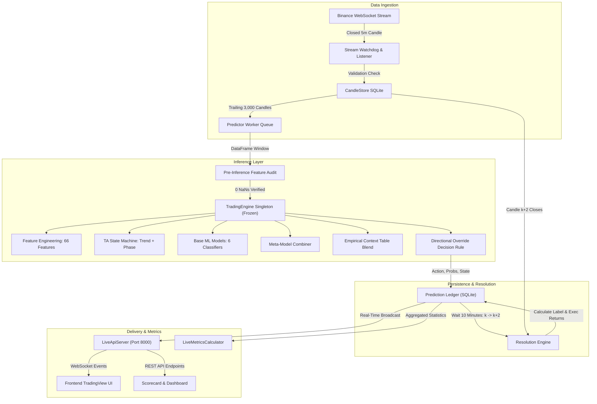
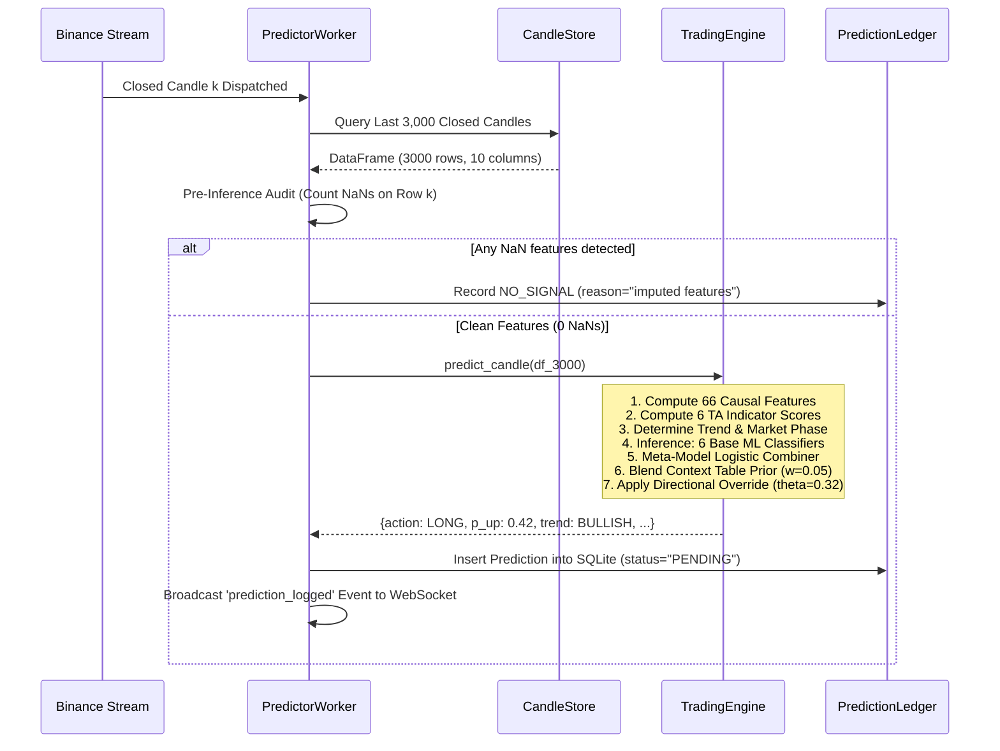

# Backend Architecture & Live Integration Specification
**BTCUSDT 5-Minute AI Trading System — Live Forward Testing & Backend Engine**

---

## 1. Executive Summary & End-to-End Pipeline

The backend layer is an asynchronous, leak-free forward-testing and inference system. Its mission is to ingest live 5-minute Bitcoin (`BTCUSDT`) market data from Binance, feed that data into the frozen Machine Learning and Technical Analysis model pipeline, record trade decisions to an immutable ledger, and automatically evaluate the accuracy of those predictions exactly 10 minutes later ($N=2$ candles) without human intervention or data leakage.



---

## 2. Directory & Module Breakdown ("Which File Does What")

All backend services are isolated inside `backend/` and `backend/live/`. The ML model code resides exclusively inside `ML/src/` and is strictly read-only.

```
backend/
├── engine.py                  # Singleton bridge between backend and ML/src/trading_engine.py
├── data/
│   ├── candles.db             # Local SQLite storage of historical and live 5m candles
│   ├── live_ledger.db         # Immutable log of all predictions and evaluated outcomes
│   ├── replay_candles.db      # Isolated DB for historical replay simulations
│   ├── replay_ledger.db       # Isolated DB for replay evaluation logs
│   └── archive/               # Timestamped archives of previous live runs
├── live/
│   ├── __init__.py
│   ├── config.py              # Frozen hyperparameters, paths, network URLs, buffer sizes
│   ├── stream.py              # Binance WebSocket listener with auto-reconnect & watchdog
│   ├── candle_store.py        # Candle validation, SQLite persistence, and REST backfill
│   ├── predictor.py           # Async worker for ML inference, feature audit, and resolution
│   ├── ledger.py              # Database transactions for predictions, states, and scores
│   ├── metrics.py             # Directional accuracy, binomial tests, and latency scorecards
│   ├── api.py                 # Unified HTTP REST and WebSocket server for frontend
│   └── run.py                 # CLI launcher for live forward testing and historical replay
└── tests/
    ├── test_live.py           # 16 integration tests verifying parity, WS life cycle, isolation
    └── window_sensitivity.py  # Lookback buffer calibration diagnostic script
```

### Module Responsibilities

| Module | Primary Class / Functions | Core Responsibility |
| :--- | :--- | :--- |
| [`backend/engine.py`](file:///c:/B.TECH/Academics/SEMESTER%20V/03%20Machine%20Learning/.ML%20LABs/Project/Stock-Market-ML-Indicator/backend/engine.py) | `TradingEngine`, `predict_one`, `get_model_metrics` | Lightweight interface ensuring the backend accesses the model strictly via singleton pattern. |
| [`backend/live/config.py`](file:///c:/B.TECH/Academics/SEMESTER%20V/03%20Machine%20Learning/.ML%20LABs/Project/Stock-Market-ML-Indicator/backend/live/config.py) | Constants: `BUFFER_SIZE=3000`, `HORIZON=2`, etc. | Defines all immutable parameters: 23 bps cost floor, 0.32 threshold, 3,000 candle buffer. |
| [`backend/live/stream.py`](file:///c:/B.TECH/Academics/SEMESTER%20V/03%20Machine%20Learning/.ML%20LABs/Project/Stock-Market-ML-Indicator/backend/live/stream.py) | `BinanceKlineStream` | Subscribes to Binance WebSocket (`btcusdt@kline_5m`), checks 15s ping watchdogs, re-establishes dropped connections, and passes closed candles to the store. |
| [`backend/live/candle_store.py`](file:///c:/B.TECH/Academics/SEMESTER%20V/03%20Machine%20Learning/.ML%20LABs/Project/Stock-Market-ML-Indicator/backend/live/candle_store.py) | `CandleStore` | Validates candle math ($High \ge \max(O,C)$, $Low \le \min(O,C)$, volume $\ge 0$), executes paginated 3,000-candle REST backfill on startup, and saves closed candles. |
| [`backend/live/predictor.py`](file:///c:/B.TECH/Academics/SEMESTER%20V/03%20Machine%20Learning/.ML%20LABs/Project/Stock-Market-ML-Indicator/backend/live/predictor.py) | `PredictorWorker` | Consumes closed candles from an async queue, audits feature NaNs before inference, executes `predict_candle`, logs to ledger, and resolves past predictions. |
| [`backend/live/ledger.py`](file:///c:/B.TECH/Academics/SEMESTER%20V/03%20Machine%20Learning/.ML%20LABs/Project/Stock-Market-ML-Indicator/backend/live/ledger.py) | `PredictionLedger` | Manages SQLite CRUD for predictions, logs execution commits, transitions states (`PENDING` $\to$ `RESOLVED`), and calculates label/executable returns. |
| [`backend/live/metrics.py`](file:///c:/B.TECH/Academics/SEMESTER%20V/03%20Machine%20Learning/.ML%20LABs/Project/Stock-Market-ML-Indicator/backend/live/metrics.py) | `LiveMetricsCalculator` | Generates statistical scorecards: directional accuracy, coverage, Wilson score intervals, binomial p-values vs held-out test benchmarks, and compute latency. |
| [`backend/live/api.py`](file:///c:/B.TECH/Academics/SEMESTER%20V/03%20Machine%20Learning/.ML%20LABs/Project/Stock-Market-ML-Indicator/backend/live/api.py) | `LiveApiServer` | Combines HTTP REST routes (`/api/live/*`) and real-time WebSocket broadcasting (`/ws/live`) on a single port for frontend dashboards. |
| [`backend/live/run.py`](file:///c:/B.TECH/Academics/SEMESTER%20V/03%20Machine%20Learning/.ML%20LABs/Project/Stock-Market-ML-Indicator/backend/live/run.py) | CLI Entry point | Orchestrates the entire live service stack, enforces clean git working tree hygiene, and creates automatic timestamped ledger backups. |

---

## 3. Database Architecture ("What DBs Do We Have")

All persistence is handled using **SQLite3** engines operating in **WAL (Write-Ahead Logging)** mode. SQLite was chosen because it requires no external database daemons, ensures ACID compliance across async threads, allows instant local querying, and keeps data fully isolated between live and replay modes.

### Overview of Database Files

```
backend/data/
├── candles.db          # Live production market candle cache (open, high, low, close, volume)
├── live_ledger.db      # Live forward test predictions, model inputs, and resolved returns
├── replay_candles.db   # Historical candle cache used exclusively during replay testing
├── replay_ledger.db    # Prediction and resolution ledger used exclusively during replay
└── archive/            # Auto-generated backup snapshots (live_ledger_YYYYMMDD_HHMMSS.db)
```

---

### Database 1: `candles.db`

Managed by [`CandleStore`](file:///c:/B.TECH/Academics/SEMESTER%20V/03%20Machine%20Learning/.ML%20LABs/Project/Stock-Market-ML-Indicator/backend/live/candle_store.py). Stores continuous 5-minute closed candles.

#### Table: `candles`
| Column Name | SQL Type | Description |
| :--- | :--- | :--- |
| `open_time` | `TEXT PRIMARY KEY` | Candle open timestamp in ISO 8601 UTC (e.g. `2026-11-12 10:00:00+00:00`) |
| `open` | `REAL NOT NULL` | Opening price |
| `high` | `REAL NOT NULL` | Highest price recorded in the 5m interval |
| `low` | `REAL NOT NULL` | Lowest price recorded in the 5m interval |
| `close` | `REAL NOT NULL` | Closing price at interval end |
| `volume` | `REAL NOT NULL` | Base asset volume (BTC) |
| `quote_volume` | `REAL NOT NULL` | Quote asset volume (USDT) |
| `number_of_trades` | `REAL NOT NULL` | Total number of executed trades |
| `taker_buy_base_volume`| `REAL NOT NULL` | Aggressive buyer volume in base asset (BTC) |
| `taker_buy_quote_volume`| `REAL NOT NULL` | Aggressive buyer volume in quote asset (USDT) |
| `close_time` | `TEXT NOT NULL` | Interval close timestamp |
| `received_at` | `TEXT NOT NULL` | Local wall-clock arrival timestamp |
| `source` | `TEXT NOT NULL` | Ingestion source (`"WS"` = WebSocket, `"REST"` = backfill, `"REPLAY"`) |
| `is_reconciled` | `INTEGER DEFAULT 0`| `1` if verified against official Binance REST historical archives |

*Index*: `idx_candles_close_time ON candles(close_time)`

---

### Database 2: `live_ledger.db`

Managed by [`PredictionLedger`](file:///c:/B.TECH/Academics/SEMESTER%20V/03%20Machine%20Learning/.ML%20LABs/Project/Stock-Market-ML-Indicator/backend/live/ledger.py). Records every inference event and stores the ground truth outcome 10 minutes later.

#### Table: `predictions`
| Column Name | SQL Type | Description |
| :--- | :--- | :--- |
| `candle_open_time` | `TEXT PRIMARY KEY` | Open time of the candle $k$ on which inference occurred |
| `ref_close` | `REAL NOT NULL` | Closing price $P_k$ used as reference price for return calculations |
| `target_candle_open_time`| `TEXT NOT NULL` | Open time of candle $k+2$ (10 minutes later) |
| `action` | `INTEGER NOT NULL` | Encoded decision: `+1` (LONG), `0` (NEUTRAL), `-1` (SHORT) |
| `action_label` | `TEXT NOT NULL` | Human-readable string: `"LONG"`, `"NEUTRAL"`, `"SHORT"`, or `"NO_SIGNAL"` |
| `confidence` | `REAL NOT NULL` | Decision confidence metric $\max(P_{\text{up}}, P_{\text{down}})$ |
| `p_up` | `REAL NOT NULL` | Blended meta-model probability of UP move |
| `p_neutral` | `REAL NOT NULL` | Blended meta-model probability of NEUTRAL move |
| `p_down` | `REAL NOT NULL` | Blended meta-model probability of DOWN move |
| `trend` | `TEXT NOT NULL` | TA Trend regime (`"BULLISH"`, `"BEARISH"`, `"SIDEWAYS"`) |
| `market_phase` | `TEXT NOT NULL` | Structural phase (`"IMPULSE"`, `"PULLBACK"`) |
| `model_version` | `TEXT NOT NULL` | Model semantic identifier (`"horizon_2_meta_v1"`) |
| `git_commit` | `TEXT NOT NULL` | Git SHA hash active when inference was calculated |
| `config_hash` | `TEXT NOT NULL` | SHA-256 hash of all runtime configurations and hyperparameters |
| `buffer_length` | `INTEGER NOT NULL` | Number of historical candles fed to the model (target: 3,000) |
| `compute_latency_ms` | `REAL NOT NULL` | Execution duration of the inference pipeline in milliseconds |
| `status` | `TEXT NOT NULL` | Prediction status: `"PENDING"`, `"RESOLVED"`, `"NO_SIGNAL"`, or `"STALE"` |
| `status_reason` | `TEXT` | Explanation if `NO_SIGNAL` (e.g. `"imputed features"`, `"insufficient buffer"`) |
| `n_imputed_features` | `INTEGER DEFAULT 0`| Number of feature columns that required imputation (must be 0 for valid signal) |
| `imputed_feature_names` | `TEXT DEFAULT '[]'`| JSON list of feature names that were imputed |
| `exchange_close_time` | `TEXT` | Exchange timestamp when candle $k$ closed |
| `exchange_event_time_ms`| `INTEGER` | Exchange WebSocket message dispatch epoch |
| `outcome_close` | `REAL` | Closing price $P_{k+2}$ of candle $k+2$ (populated upon resolution) |
| `outcome_open` | `REAL` | Opening price $O_{k+1}$ of candle $k+1$ (populated upon resolution) |
| `actual_raw_sign_2` | `REAL` | Ground truth sign of the price move: $\text{sign}(P_{k+2} - P_k)$ |
| `actual_target_2_S1` | `REAL` | Ground truth 3-class target accounting for 23 bps cost floor |
| `correct` | `INTEGER` | `1` if predicted action matched actual directional outcome, `0` otherwise |
| `return_bps_label` | `REAL` | Primary label return: $\text{action} \times \frac{P_{k+2} - P_k}{P_k} \times 10,000$ |
| `return_bps_executable`| `REAL` | Secondary executable return: $\text{action} \times \frac{P_{k+2} - O_{k+1}}{O_{k+1}} \times 10,000$ |
| `created_at` | `TEXT NOT NULL` | Prediction recording timestamp (ISO 8601 UTC) |
| `resolved_at` | `TEXT` | Outcome resolution timestamp (ISO 8601 UTC) |

*Indexes*:
- `idx_pred_status ON predictions(status)`
- `idx_pred_target_time ON predictions(target_candle_open_time)`

#### Table: `run_start`
Maintains forward-test audit compliance. Every time the live engine boots, a new record is saved:
| Column Name | SQL Type | Description |
| :--- | :--- | :--- |
| `id` | `INTEGER PRIMARY KEY` | Auto-incrementing run session ID |
| `start_time` | `TEXT NOT NULL` | Startup timestamp (UTC) |
| `git_commit` | `TEXT NOT NULL` | Codebase commit hash at launch |
| `git_tag` | `TEXT` | Expected Git release tag (e.g. `step-10b-parity`) |
| `buffer_size` | `INTEGER NOT NULL` | Lookback buffer configuration (3,000) |
| `config_hash` | `TEXT NOT NULL` | SHA-256 fingerprint of the configuration |
| `clean_repo_asserted` | `INTEGER NOT NULL` | `1` if repository was clean at boot, `0` if launched with `--allow-dirty` |

---

## 4. How the Backend Communicates with the ML Model

### The Singleton Pattern (`TradingEngine`)
The Machine Learning models consist of 6 trained base estimators, 1 meta-model combiner, and an empirical context table located in `ML/models/horizon_2/`. 

To eliminate disk I/O latency and prevent redundant memory allocations on every candle, the model is initialized once via the `TradingEngine.get_instance()` singleton in [`backend/engine.py`](file:///c:/B.TECH/Academics/SEMESTER%20V/03%20Machine%20Learning/.ML%20LABs/Project/Stock-Market-ML-Indicator/backend/engine.py):

```python
from backend.engine import TradingEngine

# Retrieves the warmed-up, in-memory singleton
engine = TradingEngine.get_instance()
```

### Why 3,000 Candles Are Required (Live/Offline Parity)
During forward testing, inference for a single timestamp must be identical to batch backtesting. In Step 10b, lookback sensitivity diagnostics proved:
1. **7-Day Seasonal Volatility** (`feat_vol_seasonal_slot_abs_ret_7d`) & **HAR Variance** (`feat_vol_har_ratio_288_2016`) require:
   $$7\text{ days} \times 288\text{ candles/day} = 2,016\text{ five-minute candles}$$
2. **100-Hour Resampled Moving Average** (`feat_ma_1h_ema_ratio_100`) requires:
   $$100\text{ hours} \times 12\text{ candles/hour} = 1,200\text{ five-minute candles}$$

If a buffer smaller than 2,016 candles is supplied, these features produce `NaN` on the inference row, triggering fallback zero-imputation and distorting model probabilities. By configuring `BUFFER_SIZE = 3000` (~10.4 days of 5m candles), **0 features are imputed**, achieving **100% action match** and $< 10^{-4}$ probability difference against full offline batch inference.

### Step-by-Step Inference Flow (`predict_candle`)



---

## 5. How the Frontend Communicates with the Backend

The frontend dashboard communicates with the backend via two channels:
1. **Real-time WebSocket (`ws://localhost:8000/ws/live`)**: Pushes streaming candle ticks, newly formed predictions, and resolution outcomes immediately to the UI without polling.
2. **REST API (`http://localhost:8000/api/*`)**: Pulls tabular predictions, system status, historical backtests, and statistical scorecards.

---

### WebSocket API: `ws://localhost:8000/ws/live`

Connect using any standard browser WebSocket client:
```javascript
const ws = new WebSocket("ws://localhost:8000/ws/live");

ws.onopen = () => console.log("Connected to AI Trading Engine");
ws.onmessage = (event) => {
    const message = JSON.parse(event.data);
    console.log("Event:", message.event, message.data);
};
```

#### Event Catalog

#### 1. `initial_status`
Dispatched immediately when the client connects.
```json
{
  "event": "initial_status",
  "data": {
    "state": "LIVE",
    "mode": "LIVE",
    "uptime_seconds": 1420.5,
    "buffer_length": 3000,
    "buffer_target": 3000,
    "last_closed_candle_time": "2026-11-12 10:00:00+00:00",
    "reconnect_count": 0,
    "latency_ms": 14.2,
    "forming_candle_close": 91240.50,
    "horizon_candles": 2,
    "horizon_minutes": 10,
    "cost_floor_bps": 23.0
  },
  "timestamp": "2026-11-12T10:01:00.123456+00:00"
}
```

#### 2. `latest_prediction`
Dispatched upon connection and whenever a new inference is made.
```json
{
  "event": "latest_prediction",
  "data": {
    "candle_open_time": "2026-11-12 10:00:00+00:00",
    "ref_close": 91250.00,
    "target_candle_open_time": "2026-11-12 10:10:00+00:00",
    "action": 1,
    "action_label": "LONG",
    "confidence": 0.4215,
    "p_up": 0.4215,
    "p_neutral": 0.2840,
    "p_down": 0.2945,
    "trend": "BULLISH",
    "market_phase": "IMPULSE",
    "status": "PENDING",
    "compute_latency_ms": 18.4,
    "n_imputed_features": 0
  },
  "timestamp": "2026-11-12T10:05:00.045123+00:00"
}
```

#### 3. `prediction_resolved`
Dispatched 10 minutes later when candle $k+2$ closes and the trade outcome is finalized.
```json
{
  "event": "prediction_resolved",
  "data": {
    "candle_open_time": "2026-11-12 10:00:00+00:00",
    "target_candle_open_time": "2026-11-12 10:10:00+00:00",
    "action_label": "LONG",
    "outcome_close": 91480.00,
    "outcome_open": 91260.00,
    "correct": 1,
    "return_bps_label": 25.20,
    "return_bps_executable": 24.10,
    "status": "RESOLVED",
    "resolved_at": "2026-11-12T10:15:00.012345+00:00"
  },
  "timestamp": "2026-11-12T10:15:00.015000+00:00"
}
```

---

### REST API Endpoints

All REST responses include permissive CORS headers (`Access-Control-Allow-Origin: *`) to enable seamless communication with browser single-page applications.

#### 1. `GET /api/live/status`
Returns live system health, connection stability, buffer size, and exchange latency.
- **Example Response**:
```json
{
  "state": "LIVE",
  "mode": "LIVE",
  "uptime_seconds": 3600.0,
  "buffer_length": 3000,
  "buffer_target": 3000,
  "last_closed_candle_time": "2026-11-12 10:00:00+00:00",
  "reconnect_count": 0,
  "latency_ms": 12.4,
  "forming_candle_close": 91310.25,
  "horizon_candles": 2,
  "horizon_minutes": 10,
  "cost_floor_bps": 23.0
}
```

#### 2. `GET /api/live/latest`
Returns the most recent prediction and the exact seconds remaining until resolution.
- **Example Response**:
```json
{
  "latest_prediction": {
    "candle_open_time": "2026-11-12 10:00:00+00:00",
    "ref_close": 91250.0,
    "target_candle_open_time": "2026-11-12 10:10:00+00:00",
    "action": 1,
    "action_label": "LONG",
    "confidence": 0.4215,
    "p_up": 0.4215,
    "p_neutral": 0.2840,
    "p_down": 0.2945,
    "trend": "BULLISH",
    "market_phase": "IMPULSE",
    "status": "PENDING"
  },
  "countdown_seconds_to_resolution": 245
}
```

#### 3. `GET /api/live/predictions`
Fetches historical predictions from the ledger with optional query filtering.
- **Query Parameters**:
  - `limit` (int, default: 50): Number of rows to return.
  - `status` (string, optional): Filter by `"PENDING"`, `"RESOLVED"`, or `"NO_SIGNAL"`.
  - `since` (string, optional): Return predictions strictly after this ISO timestamp.
- **Example Request**:
  `GET /api/live/predictions?limit=20&status=RESOLVED`
- **Example Response**:
```json
{
  "count": 2,
  "predictions": [
    {
      "candle_open_time": "2026-11-12 09:50:00+00:00",
      "ref_close": 91100.0,
      "action_label": "LONG",
      "status": "RESOLVED",
      "correct": 1,
      "return_bps_label": 16.46,
      "return_bps_executable": 15.20
    },
    {
      "candle_open_time": "2026-11-12 09:45:00+00:00",
      "ref_close": 91120.0,
      "action_label": "NEUTRAL",
      "status": "RESOLVED",
      "correct": null,
      "return_bps_label": 0.0,
      "return_bps_executable": 0.0
    }
  ]
}
```

#### 4. `GET /api/live/metrics`
Calculates real-time statistical performance against the frozen project benchmarks.
- **Example Response**:
```json
{
  "total_candles_recorded": 150,
  "total_resolved_candles": 148,
  "directional_calls_count": 82,
  "directional_coverage_pct": 55.41,
  "too_few_samples": true,
  "sample_size_assessment": {
    "current_calls": 82,
    "required_for_95_ci": 2700,
    "required_for_80_power": 5400,
    "status": "ACCUMULATING_SAMPLES"
  },
  "benchmarks": {
    "ref_test_accuracy_pct": 51.90,
    "ref_test_coverage_pct": 52.50,
    "ref_oof_accuracy_pct": 52.16,
    "ref_oof_coverage_pct": 65.90
  },
  "directional_accuracy": {
    "correct_calls": 44,
    "overall_pct": 53.66,
    "wilson_95_ci": [42.98, 64.01],
    "p_value_vs_random_50pct": 0.287,
    "p_value_vs_test_benchmark": 0.412
  },
  "returns": {
    "mean_return_bps_label": 8.42,
    "mean_return_bps_executable": 7.15,
    "total_cumulative_bps": 586.3
  },
  "latency": {
    "p50_ms": 14.5,
    "p90_ms": 22.1,
    "p99_ms": 38.6
  }
}
```

#### 5. `GET /api/metrics`
Returns the frozen offline model performance metrics (from the test and validation datasets).

#### 6. `GET /api/backtest`
Executes an instant simulation of the model strategy across the entire test partition and returns cumulative PnL, maximum drawdown, and trade counts.

---

## 6. Frontend TradingView UI Integration Guide

The `frontend/` directory contains a TradingView Charting Library interface (`index.html`, `trading.html`, `binance.js`, `custom-indicators.js`). 

To overlay the ML predictions on the candlestick chart:

### 1. Rendering Prediction Markers on the Chart
When receiving a `latest_prediction` or `prediction_logged` event over WebSocket, add an execution shape onto the chart widget:

```javascript
ws.onmessage = (event) => {
    const msg = JSON.parse(event.data);
    if (msg.event === "latest_prediction" || msg.event === "prediction_logged") {
        const pred = msg.data;
        const candleTimestamp = new Date(pred.candle_open_time).getTime() / 1000;

        let shape = null;
        if (pred.action_label === "LONG") {
            shape = {
                time: candleTimestamp,
                position: "belowBar",
                color: "#00E676",
                shape: "arrowUp",
                text: `LONG (${(pred.confidence * 100).toFixed(1)}%)`
            };
        } else if (pred.action_label === "SHORT") {
            shape = {
                time: candleTimestamp,
                position: "aboveBar",
                color: "#FF5252",
                shape: "arrowDown",
                text: `SHORT (${(pred.confidence * 100).toFixed(1)}%)`
            };
        }
        
        if (shape) {
            chart.createExecutionShape(shape);
        }
    }
};
```

### 2. Live Signal & Regime Header Widget
Bind the `initial_status` and `latest_prediction` data to DOM status badges:
- **Trend Badge**: Apply `.bg-green` for `BULLISH`, `.bg-red` for `BEARISH`, `.bg-gray` for `SIDEWAYS`.
- **Phase Badge**: Display `IMPULSE` (high momentum expansion) vs `PULLBACK` (reversion to moving averages).
- **Countdown Timer**: Decrement `countdown_seconds_to_resolution` every 1,000 ms to show users when the current trade outcome resolves.

---

## 7. How to Run the System

### 1. Launch in Live Forward-Testing Mode
Starts WebSocket streaming from Binance, performs 3,000-candle startup backfill, runs model inference every 5 minutes, and hosts the API on port 8000:
```bash
python -m backend.live.run --mode live
```
*Note: If you have uncommitted git changes during development, pass `--allow-dirty` to bypass the hygiene launch check:*
```bash
python -m backend.live.run --mode live --allow-dirty
```

### 2. Launch in Accelerated Historical Replay Mode
Replays historical data from `clean.csv` through the exact same WebSocket/queue pipelines at 60x real-time speed (one 5-minute candle every 5 seconds) to test the UI and scorecard:
```bash
python -m backend.live.run --mode replay --speed 60.0 --from "2026-10-01" --to "2026-10-05"
```

### 3. Run Backend Integration Tests
Executes the full test suite including live parity, lookback window gates, and gap recovery:
```bash
pytest backend/tests/test_live.py
```
