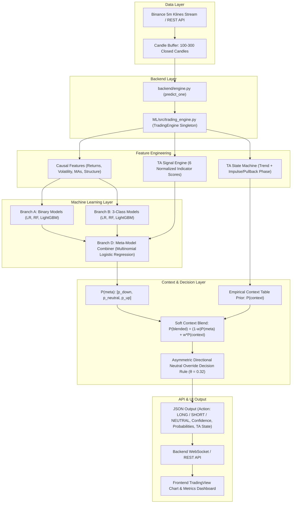

# System Architecture & Live Backend Integration Guide
**BTCUSDT 5-Minute AI Trading Indicator & Inference Pipeline**

---

## 1. Executive Summary & End-to-End Pipeline Overview

This project implements a multi-branch, leak-free Machine Learning and Technical Analysis indicator system for Bitcoin (`BTCUSDT`, 5-minute candles). 

The system operates across a **Prediction Horizon of $N=2$ candles (10 minutes)**, requiring price expansion beyond the exchange friction dead-zone floor of **$c = 23\text{ bps}$ ($0.23\%$)** to cover taker fees, slippage, and spread.

### High-Level Architecture Flow ("What Calls What")



---

## 2. Component Breakdown ("Which Function Does What")

All production inference logic is consolidated inside [`ML/src/trading_engine.py`](file:///c:/B.TECH/Academics/SEMESTER%20V/03%20Machine%20Learning/.ML%20LABs/Project/Stock-Market-ML-Indicator/ML/src/trading_engine.py) and exposed via [`backend/engine.py`](file:///c:/B.TECH/Academics/SEMESTER%20V/03%20Machine%20Learning/.ML%20LABs/Project/Stock-Market-ML-Indicator/backend/engine.py).

### Core Methods in `TradingEngine`

| Function / Method | Location | Responsibility & Behavior |
| :--- | :--- | :--- |
| `get_instance(**kwargs)` | `TradingEngine` | **Singleton Accessor:** Loads all models and metadata into memory once (`<0.5s`). Prevents redundant model reloading across API requests. |
| `_load_all_artifacts()` | `TradingEngine` | **Model Loader:** Deserializes the 6 base models, the meta-model combiner, scaler parameters, the $q_{99}$ TA parameters, and the empirical context table from disk. |
| `_prepare_features_robust()` | `TradingEngine` | **Causal Sanitizer:** Extracts exact feature columns for each model and applies fallback imputation (ffill/bfill/zero) to prevent runtime crashes during live streaming with small candle buffers. |
| `_score_base_models(df)` | `TradingEngine` | **Base Model Scorer:** Runs all 6 base models: generates $P(\text{up})$ for binary models and $[P(\text{down}), P(\text{neutral}), P(\text{up})]$ for three-class models. |
| `_get_context_prior(tr, ph, ml)` | `TradingEngine` | **Context Lookup:** Retrieves Laplace-smoothed empirical distributions $P(\text{class} \mid \text{trend}, \text{phase}, \text{ml\_pred})$ based on current technical market regime. |
| `predict_candle(df_recent)` | `TradingEngine` | **Live Single-Candle Prediction:** Takes a dataframe of recent candles (e.g. last 100–300 candles), computes causal features, executes base models, runs the meta-model, applies context blending and override rules, and returns a rich JSON dictionary for the latest closed candle. |
| `predict_batch(df)` | `TradingEngine` | **Vectorized Batch Replay:** Runs the complete multi-model pipeline across a full historical dataset. Used for historical backtesting and populating initial TradingView chart history. |
| `simulate_backtest(initial_capital, fee_bps)` | `TradingEngine` | **Financial Simulator:** Simulates trading performance on emitted signals with exact transaction cost deduction ($23\text{ bps}$ per round-trip), calculating net equity curves, win rate, Sharpe ratio, and drawdown. |
| `get_metrics()` | `TradingEngine` | **Scorecard API:** Returns the verified performance metrics (42.49% 3-class accuracy, 52.16% directional accuracy, 65.9% coverage, confusion matrix, and regime statistics) for UI display. |
| `export_production_bundle(path)` | `TradingEngine` | **Bundle Serializer:** Exports all 7 models, scalers, parameters, and metadata into a single `.joblib` archive for one-file deployment. |

### Global Helper Functions for Backend Callers

```python
from engine import predict_one, get_model_metrics, get_engine

# 1. Single candle live inference
result = predict_one(recent_candles_df)

# 2. Performance scorecard for dashboard
metrics = get_model_metrics()

# 3. Direct engine access (for batching or backtesting)
engine = get_engine()
```

---

## 3. How the Model is Exported & Stored

All model artifacts are persisted under [`ML/models/horizon_2/`](file:///c:/B.TECH/Academics/SEMESTER%20V/03%20Machine%20Learning/.ML%20LABs/Project/Stock-Market-ML-Indicator/ML/models/horizon_2/):

### Individual Component Artifacts

```text
ML/models/horizon_2/
├── binary_lr_N2.joblib           # Binary Logistic Regression (model + scaler + feature_cols)
├── binary_lr_N2.json             # Hyperparameters, random seed, training metadata
├── binary_rf_N2.joblib           # Binary Random Forest (100 trees, 1.12 MB)
├── binary_rf_N2.json
├── binary_gb_N2.joblib           # Binary LightGBM Booster
├── binary_gb_N2.json
├── three_class_lr_N2.joblib      # 3-Class Logistic Regression (multinomial)
├── three_class_lr_N2.json
├── three_class_rf_N2.joblib      # 3-Class Random Forest (1.31 MB)
├── three_class_rf_N2.json
├── three_class_gb_N2.joblib      # 3-Class LightGBM Booster (1.19 MB)
├── three_class_gb_N2.json
├── meta_model_N2.joblib          # Final Meta-Model Stacking Classifier
├── meta_model_N2.json
├── ta_params_N2.json             # Calibrated q99 threshold for TA EMA-50 score
└── context_table_N2.json         # Laplace-smoothed empirical context distributions
```

### Self-Contained Production Bundle

For production server deployment, the entire system can be packaged into a single file:
- **File:** `ML/models/horizon_2/production_bundle_N2.joblib` (~3.79 MB)
- **Contents:**
  ```python
  bundle = {
      "horizon": 2,
      "binary_models": { ... },       # All 3 binary models, scalers & feature lists
      "three_class_models": { ... },  # All 3 three-class models, scalers & feature lists
      "meta_model": { ... },          # Stacking meta-model & scaler
      "ta_params": { ... },           # TA normalization parameters
      "context_table": { ... },       # Context transition probabilities
      "config": {
          "context_weight": 0.05,
          "override_threshold": 0.32,
          "override_margin": 0.04,
          "cost_floor_bps": 23.0
      },
      "metrics": { ... }              # Precomputed validation scorecard
  }
  ```

---

## 4. How the Backend Makes API Calls to the Model

The backend accesses the model in-process via Python. Below are the recommended endpoints for a FastAPI or Flask backend service:

### 1. `POST /api/predict` — Real-Time Candle Prediction
Takes the latest window of 5-minute candles (minimum 20, recommended 100–300) and returns the trade decision for the latest closed candle.

#### Backend Implementation (FastAPI Example)
```python
from fastapi import FastAPI, HTTPException
import pandas as pd
from pydantic import BaseModel
from typing import List, Optional
from engine import predict_one

app = FastAPI(title="AI Trading Indicator API")

class CandleInput(BaseModel):
    open_time: str
    open: float
    high: float
    low: float
    close: float
    volume: float

@app.post("/api/predict")
def predict_candle_endpoint(candles: List[CandleInput]):
    if len(candles) < 20:
        raise HTTPException(status_code=400, detail="Need at least 20 historical candles.")
    
    # Convert incoming candles to DataFrame
    df = pd.DataFrame([c.dict() for c in candles])
    df["open_time"] = pd.to_datetime(df["open_time"], utc=True)
    df = df.set_index("open_time")
    
    # Generate prediction
    prediction = predict_one(df)
    return prediction
```

#### JSON Response Schema
```json
{
  "timestamp": "2026-05-21 19:25:00+00:00",
  "close_price": 77541.21,
  "action": 1,
  "action_label": "LONG",
  "signal_direction": "UP",
  "confidence": 0.3682,
  "probabilities": {
    "p_up": 0.3682,
    "p_neutral": 0.2821,
    "p_down": 0.3498
  },
  "technical_analysis": {
    "trend": "UPTREND",
    "trend_score": 0.825,
    "market_phase": "IMPULSE",
    "breakthrough_score": 1.0,
    "rsi_score": -0.0343,
    "ema50_score": 0.0188,
    "alignment_score": 0.4
  },
  "base_model_votes": {
    "binary_lr_p_up": 0.5044,
    "binary_rf_p_up": 0.5082,
    "binary_gb_p_up": 0.5095,
    "binary_consensus_up": 0.5074,
    "three_class_consensus_up": 0.3362
  },
  "economic_guardrails": {
    "cost_floor_bps": 23.0,
    "horizon_candles": 2,
    "horizon_minutes": 10,
    "expected_win_rate_pct": 52.16,
    "coverage_pct": 65.9
  }
}
```

---

### 2. `GET /api/metrics` — Dashboard Performance Scorecard
Returns precomputed verification metrics from the 110,433 held-out test candles to display in the frontend metrics cards.

#### Backend Implementation
```python
from engine import get_model_metrics

@app.get("/api/metrics")
def get_metrics_endpoint():
    return get_model_metrics()
```

#### JSON Response Example
```json
{
  "model_version": "TradingEngine-v2.0-N2",
  "overall_performance": {
    "three_class_accuracy_pct": 42.49,
    "balanced_accuracy_pct": 42.73,
    "macro_f1": 0.4243,
    "directional_accuracy_pct": 52.16,
    "coverage_pct": 65.90,
    "daily_signals_count": 189.79,
    "multiclass_log_loss": 0.9701,
    "multiclass_brier_score": 0.5752
  },
  "per_class_metrics": {
    "DOWN": {"precision_pct": 42.06, "recall_pct": 44.82, "f1": 0.4339, "support": 36462},
    "NEUTRAL": {"precision_pct": 42.23, "recall_pct": 34.61, "f1": 0.3804, "support": 37651},
    "UP": {"precision_pct": 43.14, "recall_pct": 48.77, "f1": 0.4578, "support": 36320}
  },
  "confusion_matrix": {
    "labels": ["DOWN (-1)", "NEUTRAL (0)", "UP (+1)"],
    "matrix": [
      [16343, 7659, 12460],
      [11262, 13031, 13358],
      [11262, 7343, 17715]
    ]
  }
}
```

---

### 3. `POST /api/backtest` — Interactive Backtesting Simulator
Simulates trade execution over historical signals with fee deductions.

#### Backend Implementation
```python
from engine import TradingEngine

@app.post("/api/backtest")
def run_backtest_endpoint(initial_capital: float = 10000.0, fee_bps: float = 23.0):
    engine = TradingEngine.get_instance()
    results = engine.simulate_backtest(initial_capital=initial_capital, fee_bps=fee_bps)
    return results
```

---

## 5. How to Access the Model and the Data

### 1. Accessing Historical Datasets
- **Cleaned 3-Year Canonical Dataset:** [`ML/data/processed/clean.csv`](file:///c:/B.TECH/Academics/SEMESTER%20V/03%20Machine%20Learning/.ML%20LABs/Project/Stock-Market-ML-Indicator/ML/data/processed/clean.csv) (318,240 candles from 2023-11-01 to 2026-11-09).
- **Master Dataset with Engineered Features:** `ML/data/processed/master.csv` (1.05 GB).
- **Final Combined Predictions Dataset:** `ML/data/processed/final_predictions_N2.csv.gz` (110,433 rows $\times$ 17 columns).
- **Test Set Out-of-Sample Results:** [`ML/results/horizon_2_test.csv`](file:///c:/B.TECH/Academics/SEMESTER%20V/03%20Machine%20Learning/.ML%20LABs/Project/Stock-Market-ML-Indicator/ML/results/horizon_2_test.csv) (49,940 test candles from May to Nov 2026).

### 2. Fetching Live Data from Binance REST API
To feed the model live, fetch the last 300 5-minute closed candles from Binance:

```python
import requests
import pandas as pd
from engine import predict_one

def fetch_live_binance_candles(symbol: str = "BTCUSDT", limit: int = 300) -> pd.DataFrame:
    url = f"https://api.binance.com/api/v3/klines?symbol={symbol}&interval=5m&limit={limit}"
    res = requests.get(url, timeout=10).json()
    
    # Binance klines format: [open_time, open, high, low, close, volume, close_time, quote_vol, trades, tb_base_vol, tb_quote_vol, ignore]
    df = pd.DataFrame(res, columns=[
        "open_time", "open", "high", "low", "close", "volume",
        "close_time", "quote_asset_volume", "number_of_trades",
        "taker_buy_base_volume", "taker_buy_quote_asset_volume", "ignore"
    ])
    
    # Cast numerical columns
    for col in ["open", "high", "low", "close", "volume", "taker_buy_base_volume", "number_of_trades"]:
        df[col] = df[col].astype(float)
        
    df["open_time"] = pd.to_datetime(df["open_time"], unit="ms", utc=True)
    df = df.set_index("open_time")
    
    # Exclude the active (unclosed) candle at the very end
    df_closed = df.iloc[:-1].copy()
    return df_closed

# Run live inference on latest closed candle
candles = fetch_live_binance_candles()
signal = predict_one(candles)
print(f"Action: {signal['action_label']} | Confidence: {signal['confidence'] * 100:.1f}%")
```

### 3. Strict Closed-Candle Rule (Zero Repainting)
> [!IMPORTANT]
> To prevent indicator repainting and lookahead leakage:
> - **Only run inference on closed candles** (`df.iloc[:-1]`).
> - A 5-minute candle opening at `12:00:00` closes at `12:04:59.999`. 
> - The trade signal must be evaluated at `12:05:00` and entered on the open of the subsequent candle.
> - Once emitted on a closed candle, the signal is final and immutable.

---

## 6. Verification Test Suite

The unified engine is verified by automated pytest unit tests:
```powershell
pytest ML/tests/test_trading_engine.py ML/tests/test_final_evaluation.py ML/tests/test_ta_state.py ML/tests/test_cv.py
```
- **Total Tests:** 21 passed in 34.70s.
- **Test Coverage:** Model bundle loading, single-candle prediction formatting, probability simplex verification ($\sum P = 1.0$), backtesting fee accounting, and walk-forward cross-validation integrity.
