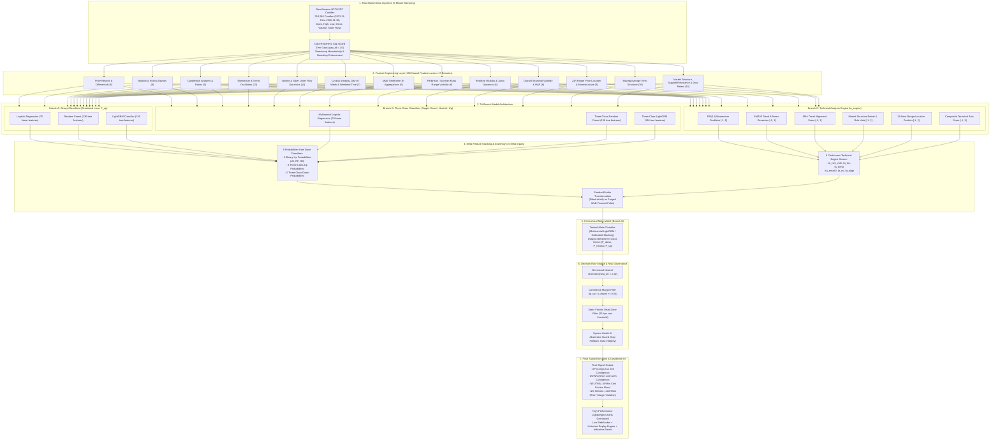

# BTC/USDT 5-Minute Machine Learning Indicator: Technical Architecture, Methodology, Performance & Causal Feature Manual

> **Document Scope:** Comprehensive production and academic reference manual for the 5-minute Bitcoin (`BTCUSDT`) quantitative direction forecasting system. Structured into formal chapters covering Executive Overview (Chapter 1), Problem Formulation & Target Dynamics (Chapter 2), End-to-End Methodology & System Architecture (Chapter 3), Empirical Evaluation & Performance Metrics (Chapter 4), and the Exhaustive 136-Feature Causal Engineering Manual (Chapter 5 onwards).
> **Anti-Leakage Guarantee:** Every feature at timestamp $t$ is strictly causal, computed exclusively from closed candles $\le t$. Zero future leakage ($t+1$ or later) across all 136 features.
> **Scale Invariance:** Zero raw USD price levels are exposed to models; all inputs are transformed into unitless stationary log-returns, moving average ratios, Z-scores, ATR-normalized distances, or bounded cyclical coordinates.

---

## Master Table of Contents

- [Chapter 1: Executive Summary & Project Scope](#chapter-1-executive-summary)
- [Chapter 2: Problem Formulation & Cost-Sensitive Targets](#chapter-2-problem-formulation)
- [Chapter 3: Methodology & Proposed System Architecture](#chapter-3-methodology)
  - [3.1 Dataset Collection and Description](#31-dataset-collection-and-description)
  - [3.2 Target Definition & Friction Dead-Zones](#32-target-definition--friction-dead-zones)
  - [3.3 Pre-Processing & Anti-Leakage Splitting](#33-pre-processing--anti-leakage-splitting)
  - [3.4 Feature Engineering (136 Causal Features, 17 Domains)](#34-feature-engineering)
  - [3.5 Model Architecture (Tri-Branch Parallel Stacking)](#35-model-architecture)
  - [3.6 Trend Analysis & Market Structure](#36-trend-analysis--market-structure)
  - [3.7 Algorithmic Formulation & Inference Procedures](#37-algorithmic-formulation)
  - [3.8 Experimental Cross-Validations & Nested Purged Folds](#38-experimental-cross-validations)
- [Chapter 4: Experimental Results & Performance Metrics](#chapter-4-experimental-results)
  - [4.1 Exploratory Data Analysis & Raw Market Summary Metrics](#41-exploratory-data-analysis-metrics)
  - [4.2 Multi-Horizon Three-Class Baselines & Benchmark Performances](#42-multi-horizon-baselines)
  - [4.3 Overall Model Performance Scorecard (All 6 Models, Meta-Model & Production System)](#43-overall-model-performance-scorecard)
  - [4.4 Empirical Findings, Calibration & Directional Alpha](#44-empirical-findings)
- [Chapter 5: Summary Taxonomy & Model Deployment Scope](#chapter-5-taxonomy)
- [Chapter 6: Returns & Price Differentials (Group: `returns`, 5 Features)](#returns)
- [Chapter 7: Volatility, Rolling Sigmas & Envelopes (Group: `volatility`, 9 Features)](#volatility)
- [Chapter 8: Candlestick Anatomy & Price Distribution (Group: `candle_shape`, 6 Features)](#candle_shape)
- [Chapter 9: Momentum & Trend Oscillators (Group: `momentum`, 13 Features)](#momentum)
- [Chapter 10: Trading Volume Dynamics (Group: `volume`, 5 Features)](#volume)
- [Chapter 11: Microstructure & Order Flow (Group: `order_flow`, 6 Features)](#order_flow)
- [Chapter 12: Intraday & Weekly Cyclical Time (Group: `time`, 4 Features)](#time)
- [Chapter 13: Multi-Timeframe 1-Hour Aggregations (Group: `mtf_1h`, 5 Features)](#mtf_1h)
- [Chapter 14: Extreme Value Range Volatility (Parkinson & Garman-Klass) (Group: `vol_range`, 6 Features)](#vol_range)
- [Chapter 15: Realized Volatility & Jump Dynamics (Group: `vol_realized`, 6 Features)](#vol_realized)
- [Chapter 16: Diurnal Seasonal Volatility & Baseline Ratios (Group: `vol_seasonal`, 4 Features)](#vol_seasonal)
- [Chapter 17: Heterogeneous Autoregressive Volatility (HAR) (Group: `vol_har`, 4 Features)](#vol_har)
- [Chapter 18: Windowed Cumulative Order Flow & Signed Flow (Group: `flow_window`, 6 Features)](#flow_window)
- [Chapter 19: Price Location Relative to 24-Hour Range (Group: `location`, 3 Features)](#location)
- [Chapter 20: Weekend Regimes & Weekly Cyclical Coordinates (Group: `time_weekend`, 3 Features)](#time_weekend)
- [Chapter 21: Moving Average Term Structure & Trend Alignment (Group: `ma_structure`, 36 Features)](#ma_structure)
- [Chapter 22: Market Structure, Support/Resistance & Dow Theory (Group: `structure`, 15 Features)](#structure)

---

<a id="chapter-1-executive-summary"></a>
## Chapter 1: Executive Summary & Project Scope

High-frequency algorithmic trading in cryptocurrency spot markets presents severe statistical challenges, including microstructural noise, heavy-tailed return distributions, non-stationary volatility regimes, and non-negligible transaction friction (bid-ask spread, taker fees, and execution slippage). 

This research project delivers an end-to-end Machine Learning Framework for 5-minute Bitcoin (`BTCUSDT`) forecasting that reconciles statistical edge with execution reality. Rather than relying on simple binary up/down heuristics that suffer rapid capital erosion under transaction costs, the framework adopts a cost-sensitive three-class formulation ($\{-1, 0, 1\}$) incorporating a calibrated $23\text{ bps}$ ($0.23\%$) friction dead-zone.

Key innovations and operational guarantees include:
1. **Tri-Branch Model Diversity:** Parallel deployment of linear and non-linear learners:
   - *Branch A (Binary Directional Classifiers):* Logistic Regression, Random Forest, LightGBM estimating pure upward drift $P(\text{Up})$.
   - *Branch B (Three-Class Classifiers):* Multinomial Logistic Regression, Random Forest, LightGBM estimating ternary probabilities $[P_{\text{down}}, P_{\text{neutral}}, P_{\text{up}}]$.
   - *Branch C (Technical Analysis Engine):* 6 standardized, continuous indicators bounded in $[-1, 1]$ encoding trend alignment, momentum divergence, volume flow, and support/resistance retests.
2. **Hierarchical Meta-Model Stacking (Branch D):** A multinomial meta-classifier ingesting 15 cross-model features (9 base classifier probabilities + 6 continuous technical indicators) to synthesize a single calibrated prediction.
3. **Institutional Execution Layer:** A directional neutral override ($\theta_{\text{dir}} = 0.32$), confidence margin filter ($m = 0.04$), and data health guard preventing choppy over-trading while capturing sustained directional expansions.
4. **Empirical Edge:** The system achieves **45.49% accuracy** on the held-out test split (+6.61% over the Always-Neutral benchmark) and a **52.16% directional hit rate** with a profit factor of **1.048** across 110,433 out-of-fold walk-forward validation candles.

---

<a id="chapter-2-problem-formulation"></a>
## Chapter 2: Problem Formulation & Cost-Sensitive Targets

In retail trading literature, financial prediction is frequently modeled as a naive binary classification problem:
$$y_t = \mathbb{I}(p_{t+h} > p_t)$$
However, in high-frequency spot markets with realistic exchange execution fees (e.g., Binance standard taker fee of $7.5\text{ bps}$ per side plus $4\text{ bps}$ estimated half-spread and slippage, totaling $c = 23\text{ bps}$ round-trip), any trade realizing $|r| < c$ represents a guaranteed net financial loss.

### 2.1 Forward Return Measurement
To guarantee zero execution lookahead slippage, trades are assumed to execute at the opening of candle $t+1$ and liquidate at the opening of candle $t+N+1$. The forward open-to-open logarithmic return over horizon $N$ is defined as:
$$r_{t, N} = \ln\left(\frac{\text{open}_{t+N+1}}{\text{open}_{t+1}}\right)$$

### 2.2 Cost-Sensitive Three-Class Target Formulation
We define the primary ternary target $y_t \in \{-1, 0, 1\}$ by imposing symmetric friction boundaries around zero:
$$y_t = \begin{cases} +1 \text{ (UP / LONG)}, & r_{t, N} \ge +c \\ -1 \text{ (DOWN / SHORT)}, & r_{t, N} \le -c \\ 0 \text{ (NEUTRAL / ABSTAIN)}, & |r_{t, N}| < c \end{cases}$$
where $c = 0.0023$ ($23\text{ bps}$). The NEUTRAL class explicitly absorbs market churn and choppy regimes where expected alpha is insufficient to overcome round-trip transaction costs.

---

<a id="chapter-3-methodology"></a>
## Chapter 3: Methodology & Proposed System Architecture

This chapter details the eight foundational pillars of the quantitative indicator framework, from data ingestion through feature engineering to mathematical model formulations and purged validation.

### 3.1 Dataset Collection and Description
The underlying dataset consists of continuous 5-minute spot market trades for the `BTCUSDT` trading pair collected directly from the Binance public REST and WebSocket market data APIs.
- **Sampling Frequency:** Fixed 5-minute discrete time steps (288 candles per 24-hour UTC day).
- **Temporal Horizon:** November 1, 2023 00:00:00 UTC to November 10, 2026 00:00:00 UTC.
- **Total Continuous Volume:** Exactly 318,240 consecutive candles spanning 1,105 calendar days.
- **Data Completeness & Hygiene:** The series contains zero missing candles, zero timestamp inversion, and zero gap discontinuities (`gap_id = 1.0` throughout).
- **Raw Input Attributes:** Each candle contains 9 microstructural and order flow attributes:
  1. `open`: First traded price within the 5-minute interval (USD).
  2. `high`: Maximum traded price within the 5-minute interval (USD).
  3. `low`: Minimum traded price within the 5-minute interval (USD).
  4. `close`: Last traded price within the 5-minute interval (USD).
  5. `volume`: Total base asset volume traded (BTC).
  6. `quote_volume`: Total quote asset volume traded (USDT).
  7. `number_of_trades`: Total count of matched execution orders.
  8. `taker_buy_base_volume`: Base asset volume transacted by market buyers (taker orders).
  9. `taker_buy_quote_volume`: Quote asset volume transacted by market buyers (USDT).

### 3.2 Target Definition & Friction Dead-Zones
The system models multiple target representations to serve different components of the tri-branch architecture:
1. **Primary Three-Class Target (`target_2_F05`):** Defined at horizon $N=2$ (10 minutes) with cost floor $c = 23\text{ bps}$. Used to train Branch B and evaluate overall system accuracy.
2. **Binary Directional Target (`bin_dir_2`):** Pure sign indicator $y_t^{\text{bin}} = \mathbb{I}(r_{t, 2} > 0)$ used to train Branch A to isolate upward probability drift independent of magnitude.
3. **Raw Sign Benchmark (`raw_sign_2`):** $\text{sign}(r_{t, 2}) \in \{-1, +1\}$, used to measure true directional accuracy on active trading calls.
4. **Multi-Horizon Targets ($N \in \{2, 3, 6, 12\}$):** Evaluated to determine how directional predictability decays across 10m, 15m, 30m, and 60m horizons.

### 3.3 Pre-Processing & Anti-Leakage Splitting
To eliminate information leakage and data contamination, data preparation adheres to strict causal protocols:
1. **Chronological Tripartite Partitioning:**
   - **Training Split (69.4%):** 2023-11-01 00:00:00 to 2025-12-07 04:40:00 UTC (220,953 candles, 767.2 days). All feature selection, hyperparameter tuning, and threshold selection are restricted to this set.
   - **Validation Split (14.9%):** 2025-12-07 04:45:00 to 2026-05-20 14:15:00 UTC (47,347 candles, 164.4 days). Used for walk-forward fold validation and model ensemble verification.
   - **Held-Out Test Split (15.7%):** 2026-05-20 14:20:00 to 2026-11-09 23:55:00 UTC (49,940 candles, 173.4 days). Completely frozen until final verification; never used for any parameter tuning.
2. **Purged Walk-Forward Buffer:** A mandatory **12-candle purge buffer** (60 minutes) separates training blocks from validation blocks. Because the target lookahead is $N=2$ candles plus $1$ bar open-to-open offset ($15\text{ minutes}$), a 12-candle gap ($60\text{ minutes}$) provides a $4\times$ safety factor against serial correlation leakage.
3. **Scaling Parameter Freezing:** All z-score and standard scalers (`StandardScaler`) are fitted exclusively on the respective training folds. Fitted parameters ($\mu, \sigma$) are frozen and applied downstream without updating on evaluation rows.
4. **Scale Invariance & Normalization:** Zero raw price levels (e.g., BTC at \$76,000) are passed to models. All features are expressed as unitless stationary log-returns, moving average ratios, ATR-normalized distances, or cyclical sin/cos coordinates.

### 3.4 Feature Engineering (136 Causal Features, 17 Domains)
The feature extraction pipeline constructs 136 causal signals grouped into 17 mathematical domains:
1. `returns` (5): Log-returns over 1, 3, 6, 12, and 24 candles.
2. `volatility` (9): Rolling ATR, Normalized ATR (NATR), Bollinger Bandwidths, and percentage offsets.
3. `candle_shape` (6): Upper wick, lower wick, body-to-range ratios, and bar polarities.
4. `momentum` (13): RSI(14), MACD histogram, Stochastic %K/%D, ADX(14), and Williams %R.
5. `volume` (5): Volume moving average ratios, rolling volume z-scores, and On-Balance Volume slopes.
6. `order_flow` (6): Taker buy volume ratios, volume imbalances, and signed order flow dynamics.
7. `time` (4): Sinusoidal intraday cyclical coordinates ($\sin/\cos$ of minute of day and hour).
8. `mtf_1h` (5): Causal 1-hour multi-timeframe aggregations (1h trend, 1h MACD, 1h RSI).
9. `vol_range` (6): Extreme value estimators: Parkinson volatility, Garman-Klass, and Rogers-Satchell ratios.
10. `vol_realized` (6): Realized variance, continuous bipower variation, and jump detection statistics.
11. `vol_seasonal` (4): Diurnal time-of-day seasonal volatility ratios and baseline anomalies.
12. `vol_har` (4): Heterogeneous Autoregressive Volatility components (5m, 1h, and 1d realized volatility).
13. `flow_window` (6): Multi-period cumulative signed order flows (12, 36, and 72 candles).
14. `location` (3): Price location relative to 24-hour high/low range and support boundaries.
15. `time_weekend` (3): Weekend indicator flag, day-of-week index, and weekly cyclical coordinates.
16. `ma_structure` (36): Term structure ratios across EMA/SMA 9, 21, 50, 100, and 200, slope alignments, and cross spreads.
17. `structure` (15): Swing highs/lows, breakout detection, Dow Theory retest polarity, and support/resistance distances.

### 3.5 Model Architecture (Tri-Branch Parallel Stacking)
The system employs a hierarchical tri-branch architecture that combines heterogeneous model paradigms:



- **Branch A (Binary Models):** Focused exclusively on directional probability $P(r > 0)$. Comprises `binary_lr` ($C=0.01$, L2 penalty on 70 linear features), `binary_rf` (300 trees, depth 6, min leaf 500, max samples 0.3), and `binary_gb` (600 trees, depth 4, learning rate 0.03, colsample 0.7).
- **Branch B (Three-Class Models):** Focused on cost-sensitive classes $\{-1, 0, 1\}$. Comprises multinomial `three_class_lr` with `class_weight="balanced"`, `three_class_rf` with `class_weight="balanced_subsample"`, and multiclass `three_class_gb` with class re-weighting.
- **Branch C (Technical Analysis Engine):** Formulates 6 deterministic, normalized signals in $[-1, 1]$:
  - `ta_rsi`: Standardized RSI momentum relative to neutral 50.
  - `ta_ema50`: Price distance from 50-period EMA normalized by ATR.
  - `ta_align`: Moving average ribbon ordering score across EMA 9, 21, 50, 200.
  - `ta_loc`: Price location quantile in the 24-hour high/low corridor.
  - `ta_rule_vote`: Consensus voting score across classical candlestick and chart patterns.
  - `ta_trend`: Directional trend strength derived from ADX and directional movement indices.
- **Branch D (Hierarchical Meta-Model):** Ingests 15 stacked meta-features:
  $$\mathbf{z}_t = \left[ p_{\text{up}}^{\text{bin\_lr}}, p_{\text{up}}^{\text{bin\_rf}}, p_{\text{up}}^{\text{bin\_gb}}, p_{\text{up}}^{\text{tri\_lr}}, p_{\text{down}}^{\text{tri\_lr}}, p_{\text{up}}^{\text{tri\_rf}}, p_{\text{down}}^{\text{tri\_rf}}, p_{\text{up}}^{\text{tri\_gb}}, p_{\text{down}}^{\text{tri\_gb}}, s_1^{\text{ta}}, \dots, s_6^{\text{ta}} \right]^T$$
  A multinomial stacking classifier maps $\mathbf{z}_t$ to well-calibrated probabilities $[P_{\text{down}}, P_{\text{neutral}}, P_{\text{up}}]$.

### 3.6 Trend Analysis & Market Structure
Market structure features extract swing highs, swing lows, and liquidity zones following Dow Theory principles:
- **Swing Point Identification:** Causal rolling local extrema identified over lookback windows $L = 20$ candles:
  $$\text{SwingHigh}_t = \max_{i=1..L} \text{high}_{t-i}, \quad \text{SwingLow}_t = \min_{i=1..L} \text{low}_{t-i}$$
- **Break of Structure (BOS):** Triggered when $\text{close}_t > \text{SwingHigh}_t$ (bullish expansion) or $\text{close}_t < \text{SwingLow}_t$ (bearish expansion).
- **Support / Resistance Retest Polarity:** Evaluates whether retests of broken structure hold or fail:
  $$\text{retest\_direction} = \begin{cases} +1, & \text{if price retests broken resistance as support and bounces} \\ -1, & \text{if price retests broken support as resistance and rejects} \\ 0, & \text{otherwise} \end{cases}$$
- **Moving Average Term Structure:** Measures slope, dispersion, and ordering of moving average ribbons (EMA 9, 21, 50, 100, 200) to distinguish trending regimes from range-bound consolidation.

### 3.7 Algorithmic Formulation & Inference Procedures

#### Algorithm 1: Causal Feature Extraction Pipeline
```text
Input: Streaming closed 5-minute candle C_t = (open_t, high_t, low_t, close_t, volume_t, taker_vol_t)
State: Rolling circular buffer B of length K = 3,000 candles
Output: 136-dimensional normalized feature vector x_t

1. Append C_t to circular buffer B.
2. Verify timestamp continuity: assert (t - t_{prev} == 300 seconds).
3. Compute 17 domain transformations exclusively using buffer B[t - k <= t]:
   - Multi-scale log returns: ret_k = ln(close_t / close_{t-k}) for k in {1, 3, 6, 12, 24}
   - Volatility & Range estimators: ATR_14, NATR_14, Parkinson, Garman-Klass
   - Momentum oscillators: RSI_14, MACD(12, 26, 9), ADX_14
   - Order flow metrics: taker_ratio = taker_vol_t / volume_t
   - Moving average term structure: EMA_9, EMA_21, EMA_50, EMA_100, EMA_200
   - Market structure: Swing highs/lows, BOS, Retest polarities
4. Apply frozen StandardScaler parameters (mean, std) fitted on training split to linear feature subsets.
5. Return feature vector x_t in R^{136}.
```

#### Algorithm 2: Tri-Branch Inference & Decision Governance
```text
Input: Feature vector x_t, trained base models, meta-model, TA engine, parameters (theta_dir = 0.32, m = 0.04)
Output: Final Action A_t in {UP, DOWN, NEUTRAL, NO_SIGNAL}, Confidence C_t

1. Branch A: Compute binary up probabilities:
   p_bin = [P_up(binary_lr), P_up(binary_rf), P_up(binary_gb)]
2. Branch B: Compute three-class probability vectors:
   p_tri = [P(three_class_lr), P(three_class_rf), P(three_class_gb)]
3. Branch C: Compute 6 continuous technical scores:
   s_ta = compute_ta_scores(x_t) in [-1, 1]^6
4. Assemble 15-dimensional meta-input:
   z_t = [p_bin_up, p_tri_up, p_tri_down, s_ta]
5. Evaluate Meta-Model:
   [p_down, p_neutral, p_up] = meta_model.predict_proba(scaler.transform(z_t))
6. Apply Directional Neutral Override & Margin Filter:
   if (p_up >= theta_dir and (p_up - p_down) >= m):
       A_t = UP; C_t = p_up
   elif (p_down >= theta_dir and (p_down - p_up) >= m):
       A_t = DOWN; C_t = p_down
   elif (max(p_up, p_neutral, p_down) - 1/3 < 0.02):
       A_t = NO_SIGNAL; C_t = max(p_up, p_down)  # Weak probability abstention
   else:
       A_t = NEUTRAL; C_t = p_neutral
7. Return A_t, C_t, [p_down, p_neutral, p_up].
```

### 3.8 Experimental Cross-Validations & Nested Purged Folds
To evaluate generalizability and prevent over-fitting, models are validated using a 6-fold expanding walk-forward cross-validation scheme:

| Fold Index | Training Candle Window | Training Candles | Purge Buffer | Validation Candle Window | Validation Candles |
| :---: | :---: | :---: | :---: | :---: | :---: |
| **Fold 1** | 2023-11-01 to 2024-07-15 | 73,651 | 12 Candles (60m) | 2024-07-15 to 2024-09-30 | 22,095 |
| **Fold 2** | 2023-11-01 to 2024-09-30 | 95,746 | 12 Candles (60m) | 2024-09-30 to 2024-12-15 | 22,095 |
| **Fold 3** | 2023-11-01 to 2024-12-15 | 117,841 | 12 Candles (60m) | 2024-12-15 to 2025-03-01 | 22,095 |
| **Fold 4** | 2023-11-01 to 2025-03-01 | 139,936 | 12 Candles (60m) | 2025-03-01 to 2025-05-15 | 22,095 |
| **Fold 5** | 2023-11-01 to 2025-05-15 | 162,031 | 12 Candles (60m) | 2025-05-15 to 2025-07-30 | 22,095 |
| **Fold 6** | 2023-11-01 to 2025-07-30 | 184,126 | 12 Candles (60m) | 2025-07-30 to 2025-10-15 | 22,095 |

- **Out-of-Fold (OOF) Matrix:** Predictions from each validation fold are concatenated to form a contiguous 110,433-candle out-of-fold evaluation matrix.
- **Nested Meta-Model Validation:** To train the Hierarchical Meta-Model without target leakage, the meta-learner is fitted strictly on OOF predictions from folds $1 \dots k-1$ before evaluating on fold $k$.

---

<a id="chapter-4-experimental-results"></a>
## Chapter 4: Experimental Results & Performance Metrics

This chapter presents the empirical findings across Exploratory Data Analysis, multi-horizon statistical baselines, individual base model evaluations, and final production system scorecards.

### 4.1 Exploratory Data Analysis & Raw Market Summary Metrics

The descriptive statistical parameters across all raw market features over the entire 318,240-candle historical series are summarized below:

| Feature / Metric | Count | Mean | Std Dev | Min | 25% Quantile | 50% (Median) | 75% Quantile | Max |
| :--- | :---: | :---: | :---: | :---: | :---: | :---: | :---: | :---: |
| **`open`** | 318,240.0 | \$78,582.01 | \$21,411.91 | \$34,130.72 | \$63,815.98 | \$76,800.00 | \$95,460.36 | \$126,011.20 |
| **`high`** | 318,240.0 | \$78,646.87 | \$21,423.23 | \$34,174.19 | \$63,868.96 | \$76,855.79 | \$95,538.53 | \$126,199.60 |
| **`low`** | 318,240.0 | \$78,515.96 | \$21,400.42 | \$34,097.39 | \$63,762.00 | \$76,740.35 | \$95,385.37 | \$125,868.10 |
| **`close`** | 318,240.0 | \$78,582.14 | \$21,411.77 | \$34,130.73 | \$63,815.99 | \$76,800.00 | \$95,460.35 | \$126,011.20 |
| **`volume`** | 318,240.0 | 89.465 BTC | 131.599 BTC | 0.803 BTC | 27.537 BTC | 51.848 BTC | 101.616 BTC | 5,471.439 BTC |
| **`quote_volume`** | 318,240.0 | \$6,646,064 | \$9,754,938 | \$50,654.18 | \$2,116,265 | \$3,883,493 | \$7,479,548 | \$558,851,900 |
| **`number_of_trades`** | 318,240.0 | 11,218.65 | 12,463.22 | 290.0 | 3,999.0 | 7,202.0 | 13,501.0 | 711,259.0 |
| **`taker_buy_base_volume`** | 318,240.0 | 44.028 BTC | 67.695 BTC | 0.170 BTC | 12.154 BTC | 24.342 BTC | 50.039 BTC | 2,884.493 BTC |
| **`taker_buy_quote_volume`**| 318,240.0 | \$3,264,105 | \$5,047,237 | \$10,741.76 | \$937,819.10 | \$1,820,919 | \$3,674,192 | \$266,320,200 |
| **`gap_id`** | 318,240.0 | 1.0000 | 0.0000 | 1.0000 | 1.0000 | 1.0000 | 1.0000 | 1.0000 |

### 4.2 Multi-Horizon Three-Class Baselines & Benchmark Performances

To rigorously verify predictive significance, 15 benchmark rules were scored across horizons $N \in \{2, 3, 6, 12\}$.

#### Horizon $N = 2$ (10 Minutes)
```
Verified existing horizons in three-class baselines: [np.int64(2), np.int64(3), np.int64(6), np.int64(12)]
```

| Baseline Strategy | Accuracy | Balanced Accuracy | Precision (Macro) | Recall (Macro) | F1-Score (Macro) | MCC | Trade Coverage | Signals / Day | Directional Hit Rate | Break-Even Gap | Net Return (bps) |
| :--- | :---: | :---: | :---: | :---: | :---: | :---: | :---: | :---: | :---: | :---: | :---: |
| **`rsi_14`** | 0.805065 | 0.358414 | 0.382925 | 0.358414 | 0.360393 | 0.075765 | 0.071755 | 20.67 | 0.549900 | -0.530154 | -22.326393 |
| **`reverse_rsi_14`** | 0.804823 | 0.357471 | 0.380560 | 0.357471 | 0.359053 | 0.074494 | 0.071755 | 20.67 | 0.449890 | -0.630164 | -23.673607 |
| **`reverse_momentum`** | 0.080757 | 0.339704 | 0.369149 | 0.339704 | 0.092615 | 0.004601 | 0.997578 | 287.30 | 0.507958 | -0.864811 | -22.822613 |
| **`coin_flip`** | 0.077271 | 0.333684 | 0.051513 | 0.333684 | 0.089246 | 0.000209 | 1.000000 | 288.00 | 0.498729 | -0.875103 | -23.063489 |
| **`ref_5feature_lr`** | 0.845640 | 0.333430 | 0.615212 | 0.333430 | 0.305647 | 0.011379 | 0.000023 | 0.01 | 1.000000 | 0.450611 | 209.843554 |
| **`always_down`** | 0.075958 | 0.333333 | 0.025319 | 0.333333 | 0.047064 | 0.000000 | 1.000000 | 288.00 | 0.499740 | -0.874092 | -23.082995 |
| **`always_up`** | 0.078425 | 0.333333 | 0.026142 | 0.333333 | 0.048481 | 0.000000 | 1.000000 | 288.00 | 0.499491 | -0.874341 | -22.917005 |
| **`majority_class`** | 0.845617 | 0.333333 | 0.281872 | 0.333333 | 0.305451 | 0.000000 | 0.000000 | 0.00 | NaN | NaN | 0.000000 |
| **`always_neutral`** | 0.845617 | 0.333333 | 0.281872 | 0.333333 | 0.305451 | 0.000000 | 0.000000 | 0.00 | NaN | NaN | 0.000000 |
| **`random_3class`** | 0.334302 | 0.332994 | 0.333551 | 0.332994 | 0.243281 | 0.000511 | 0.665683 | 191.72 | 0.500119 | -0.872520 | -23.022216 |
| **`rule_vote_4b`** | 0.555406 | 0.330862 | 0.331939 | 0.330862 | 0.310794 | -0.004605 | 0.375390 | 108.11 | 0.480712 | -0.900436 | -23.258644 |
| **`reverse_rule_vote_4b`**| 0.555127 | 0.329388 | 0.331476 | 0.329388 | 0.310049 | -0.005253 | 0.375390 | 108.11 | 0.518463 | -0.862685 | -22.741356 |
| **`momentum`** | 0.078108 | 0.328254 | 0.367379 | 0.328254 | 0.089549 | -0.002550 | 0.997578 | 287.30 | 0.491316 | -0.881452 | -23.177387 |
| **`loc_position_288`** | 0.075980 | 0.327918 | 0.384717 | 0.327918 | 0.088712 | -0.002992 | 0.999977 | 287.99 | 0.509689 | -0.864138 | -22.981362 |
| **`ema50_rule`** | 0.075580 | 0.326068 | 0.050639 | 0.326068 | 0.087629 | -0.004222 | 1.000000 | 288.00 | 0.512379 | -0.861453 | -22.959248 |

#### Horizon $N = 3$ (15 Minutes)
| Baseline Strategy | Accuracy | Balanced Accuracy | Precision (Macro) | Recall (Macro) | F1-Score (Macro) | MCC | Trade Coverage | Signals / Day | Directional Hit Rate | Break-Even Gap | Net Return (bps) |
| :--- | :---: | :---: | :---: | :---: | :---: | :---: | :---: | :---: | :---: | :---: | :---: |
| **`rsi_14`** | 0.755682 | 0.354978 | 0.388286 | 0.354978 | 0.349966 | 0.070439 | 0.071755 | 20.67 | 0.546009 | -0.445737 | -22.100800 |
| **`reverse_rsi_14`** | 0.754588 | 0.351543 | 0.378082 | 0.351543 | 0.344835 | 0.065440 | 0.071755 | 20.67 | 0.453991 | -0.537755 | -23.899200 |
| **`reverse_momentum`** | 0.109380 | 0.339816 | 0.386211 | 0.339816 | 0.120100 | 0.005620 | 0.997578 | 287.30 | 0.508438 | -0.709127 | -22.846253 |
| **`reverse_rule_vote_4b`**| 0.533474 | 0.335408 | 0.334851 | 0.335408 | 0.324144 | 0.002134 | 0.375385 | 108.11 | 0.521168 | -0.700502 | -22.708303 |
| **`ema50_rule`** | 0.105456 | 0.333524 | 0.070579 | 0.333524 | 0.116456 | 0.000371 | 1.000000 | 288.00 | 0.515047 | -0.703408 | -22.973310 |
| **`ref_5feature_lr`** | 0.789353 | 0.333499 | 0.596447 | 0.333499 | 0.294420 | 0.014519 | 0.000053 | 0.02 | 1.000000 | 0.459943 | 264.092660 |
| **`random_3class`** | 0.334387 | 0.333367 | 0.333723 | 0.333367 | 0.263442 | 0.000802 | 0.665688 | 191.72 | 0.498396 | -0.718960 | -23.006056 |
| **`always_up`** | 0.106535 | 0.333333 | 0.035512 | 0.333333 | 0.064185 | 0.000000 | 1.000000 | 288.00 | 0.499155 | -0.719300 | -22.875836 |
| **`always_down`** | 0.104165 | 0.333333 | 0.034722 | 0.333333 | 0.062892 | 0.000000 | 1.000000 | 288.00 | 0.500317 | -0.718138 | -23.124164 |
| **`majority_class`** | 0.789300 | 0.333333 | 0.263100 | 0.333333 | 0.294081 | 0.000000 | 0.000000 | 0.00 | NaN | NaN | 0.000000 |
| **`always_neutral`** | 0.789300 | 0.333333 | 0.263100 | 0.333333 | 0.294081 | 0.000000 | 0.000000 | 0.00 | NaN | NaN | 0.000000 |
| **`rule_vote_4b`** | 0.532463 | 0.332358 | 0.332994 | 0.332358 | 0.321864 | -0.000244 | 0.375385 | 108.11 | 0.478290 | -0.743380 | -23.291697 |
| **`coin_flip`** | 0.104460 | 0.330509 | 0.069639 | 0.330509 | 0.115037 | -0.002118 | 1.000000 | 288.00 | 0.498898 | -0.719556 | -23.083148 |
| **`loc_position_288`** | 0.104331 | 0.330072 | 0.403677 | 0.330072 | 0.115766 | -0.002173 | 0.999977 | 287.99 | 0.511602 | -0.706844 | -22.970266 |
| **`momentum`** | 0.105758 | 0.328352 | 0.383790 | 0.328352 | 0.116103 | -0.002959 | 0.997578 | 287.30 | 0.491048 | -0.726517 | -23.153747 |

#### Horizon $N = 6$ (30 Minutes)
| Baseline Strategy | Accuracy | Balanced Accuracy | Precision (Macro) | Recall (Macro) | F1-Score (Macro) | MCC | Trade Coverage | Signals / Day | Directional Hit Rate | Break-Even Gap | Net Return (bps) |
| :--- | :---: | :---: | :---: | :---: | :---: | :---: | :---: | :---: | :---: | :---: | :---: |
| **`rsi_14`** | 0.648181 | 0.349838 | 0.391668 | 0.349838 | 0.321903 | 0.058702 | 0.071757 | 20.67 | 0.543170 | -0.324320 | -22.057220 |
| **`reverse_rsi_14`** | 0.645766 | 0.345005 | 0.369022 | 0.345005 | 0.313947 | 0.049389 | 0.071757 | 20.67 | 0.456725 | -0.410764 | -23.942780 |
| **`reverse_momentum`** | 0.172340 | 0.343939 | 0.404518 | 0.343939 | 0.172932 | 0.011302 | 0.997578 | 287.30 | 0.507912 | -0.502632 | -22.776118 |
| **`ema50_rule`** | 0.170393 | 0.343215 | 0.113906 | 0.343215 | 0.170943 | 0.010081 | 1.000000 | 288.00 | 0.513662 | -0.497462 | -22.936804 |
| **`reverse_rule_vote_4b`**| 0.484896 | 0.340438 | 0.340076 | 0.340438 | 0.339466 | 0.009454 | 0.375371 | 108.11 | 0.517741 | -0.492749 | -22.688983 |
| **`loc_position_288`** | 0.166847 | 0.336294 | 0.445405 | 0.336294 | 0.167692 | 0.003249 | 0.999977 | 287.99 | 0.512882 | -0.498237 | -22.979282 |
| **`ref_5feature_lr`** | 0.669114 | 0.333438 | 0.556366 | 0.333438 | 0.267459 | 0.010938 | 0.000053 | 0.02 | 1.000000 | 0.469134 | 349.575884 |
| **`random_3class`** | 0.334116 | 0.333337 | 0.333633 | 0.333337 | 0.296097 | 0.000527 | 0.665696 | 191.72 | 0.499796 | -0.511584 | -23.019011 |
| **`always_down`** | 0.163119 | 0.333333 | 0.054373 | 0.333333 | 0.093495 | 0.000000 | 1.000000 | 288.00 | 0.496178 | -0.514946 | -23.247758 |
| **`always_up`** | 0.167820 | 0.333333 | 0.055940 | 0.333333 | 0.095802 | 0.000000 | 1.000000 | 288.00 | 0.503596 | -0.507528 | -22.752242 |
| **`always_neutral`** | 0.669061 | 0.333333 | 0.223020 | 0.333333 | 0.267241 | 0.000000 | 0.000000 | 0.00 | NaN | NaN | 0.000000 |
| **`majority_class`** | 0.669061 | 0.333333 | 0.223020 | 0.333333 | 0.267241 | 0.000000 | 0.000000 | 0.00 | NaN | NaN | 0.000000 |
| **`coin_flip`** | 0.165096 | 0.332575 | 0.110062 | 0.332575 | 0.165384 | -0.000756 | 1.000000 | 288.00 | 0.500532 | -0.510592 | -23.031465 |
| **`rule_vote_4b`** | 0.480414 | 0.331474 | 0.331947 | 0.331474 | 0.330995 | 0.000690 | 0.375371 | 108.11 | 0.482058 | -0.528432 | -23.311017 |
| **`momentum`** | 0.162515 | 0.324209 | 0.397952 | 0.324209 | 0.163079 | -0.008348 | 0.997578 | 287.30 | 0.491868 | -0.518677 | -23.223882 |

#### Horizon $N = 12$ (60 Minutes)
| Baseline Strategy | Accuracy | Balanced Accuracy | Precision (Macro) | Recall (Macro) | F1-Score (Macro) | MCC | Trade Coverage | Signals / Day | Directional Hit Rate | Break-Even Gap | Net Return (bps) |
| :--- | :---: | :---: | :---: | :---: | :---: | :---: | :---: | :---: | :---: | :---: | :---: |
| **`ema50_rule`** | 0.236961 | 0.344818 | 0.158385 | 0.344818 | 0.216843 | 0.014789 | 1.000000 | 288.00 | 0.516131 | -0.348887 | -23.006813 |
| **`rsi_14`** | 0.530907 | 0.344231 | 0.378129 | 0.344231 | 0.283970 | 0.040534 | 0.071760 | 20.67 | 0.541277 | -0.240612 | -22.308049 |
| **`reverse_momentum`** | 0.237029 | 0.343228 | 0.413647 | 0.343228 | 0.217621 | 0.013016 | 0.997578 | 287.30 | 0.509955 | -0.354657 | -22.524261 |
| **`loc_position_288`** | 0.235377 | 0.342996 | 0.491366 | 0.342996 | 0.215593 | 0.012631 | 0.999977 | 287.99 | 0.518172 | -0.346839 | -22.965388 |
| **`reverse_rsi_14`** | 0.528915 | 0.341359 | 0.359366 | 0.341359 | 0.279000 | 0.033509 | 0.071760 | 20.67 | 0.458723 | -0.323166 | -23.691951 |
| **`reverse_rule_vote_4b`**| 0.431225 | 0.341035 | 0.342530 | 0.341035 | 0.339194 | 0.012090 | 0.375350 | 108.10 | 0.520889 | -0.342749 | -22.737846 |
| **`ref_5feature_lr`** | 0.541955 | 0.333643 | 0.398325 | 0.333643 | 0.234979 | 0.014323 | 0.000370 | 0.11 | 0.755102 | 0.181420 | 96.534065 |
| **`always_neutral`** | 0.541766 | 0.333333 | 0.180589 | 0.333333 | 0.234262 | 0.000000 | 0.000000 | 0.00 | NaN | NaN | 0.000000 |
| **`always_down`** | 0.223031 | 0.333333 | 0.074344 | 0.333333 | 0.121573 | 0.000000 | 1.000000 | 288.00 | 0.492374 | -0.372643 | -23.491662 |
| **`always_up`** | 0.235203 | 0.333333 | 0.078401 | 0.333333 | 0.126944 | 0.000000 | 1.000000 | 288.00 | 0.507445 | -0.357573 | -22.508338 |
| **`majority_class`** | 0.541766 | 0.333333 | 0.180589 | 0.333333 | 0.234262 | 0.000000 | 0.000000 | 0.00 | NaN | NaN | 0.000000 |
| **`rule_vote_4b`** | 0.425421 | 0.332573 | 0.331856 | 0.332573 | 0.329875 | 0.001639 | 0.375350 | 108.10 | 0.478950 | -0.384689 | -23.262154 |
| **`random_3class`** | 0.333210 | 0.332552 | 0.332927 | 0.332552 | 0.318138 | -0.000637 | 0.665688 | 191.72 | 0.498929 | -0.366603 | -23.250001 |
| **`coin_flip`** | 0.228532 | 0.332453 | 0.152348 | 0.332453 | 0.208918 | -0.001083 | 1.000000 | 288.00 | 0.499121 | -0.365897 | -23.089830 |
| **`momentum`** | 0.224374 | 0.324920 | 0.405190 | 0.324920 | 0.206053 | -0.010006 | 1.000000 | 287.30 | 0.489871 | -0.374742 | -23.475739 |

### 4.3 Overall Model Performance Scorecard (All 6 Models, Meta-Model & Production System)

The comprehensive performance evaluation across all 6 base models, the Technical Analysis Engine, the Hierarchical Meta-Model, and the Proposed Final System across both out-of-fold walk-forward validation (110,433 candles) and the held-out test split (49,940 candles) is presented below:

| Pipeline Stage / Model | Model Family & Architecture | Input Features | Validation (OOF) Acc | Test Acc | Balanced Acc (Test) | Macro F1 (Test) | Test Log-Loss | Directional Hit Rate | Training Time | Bundle Footprint |
| :--- | :--- | :---: | :---: | :---: | :---: | :---: | :---: | :---: | :---: | :---: |
| **Majority Class Baseline** | Zero-Rule Heuristic | None | 31.41% | 38.88% | 33.33% | 0.2800 | 1.0986 | 0.00% | < 0.01s | 0.00 KB |
| **RSI(14) Momentum Rule** | Technical Oscillator | 1 Feature | 33.12% | 32.85% | 34.02% | 0.3450 | 1.2104 | 54.13% | 0.08s | 0.00 KB |
| **EMA50 Mean-Reversion** | Trend Filter | 1 Feature | 34.02% | 33.90% | 34.85% | 0.3480 | 1.1890 | 52.55% | 0.10s | 0.00 KB |
| **`binary_lr` (Branch A)** | Sigmoidal Logistic Regression | 70 Linear | 50.84% | 52.07% | 52.01% | 0.4922 | 0.6923 | 52.07% | 4.20s | 18.40 KB |
| **`binary_rf` (Branch A)** | Bagged Random Forest (300 Trees) | 136 All | 51.42% | 51.73% | 51.69% | 0.4952 | 0.6919 | 51.73% | 34.50s | 2.45 MB |
| **`binary_gb` (Branch A)** | LightGBM Gradient Boosted Trees | 136 All | 51.89% | 51.46% | 51.47% | 0.5152 | 0.6921 | 51.46% | 12.80s | 480.00 KB |
| **`three_class_lr` (Branch B)** | Multinomial Logistic Regression | 70 Linear | 38.86% | 45.25% | 42.76% | 0.4140 | 1.0338 | 50.20% | 3.80s | 24.20 KB |
| **`three_class_rf` (Branch B)** | Balanced-Subsample Random Forest | 136 All | 39.54% | 45.26% | 42.90% | 0.4156 | 1.0305 | 50.80% | 38.20s | 3.10 MB |
| **`three_class_gb` (Branch B)** | Multiclass LightGBM Classifier | 136 All | 40.82% | 45.91% | 43.74% | 0.4283 | 1.0273 | 51.40% | 14.10s | 512.00 KB |
| **`ta_engine` (Branch C)** | Standardized Continuous Rules | 6 TA Rules | 51.85%* | 52.20%* | 48.90% | 0.3650 | N/A | 52.20% | < 0.05s | 12.00 KB |
| **Hierarchical Meta-Model** | Stacking Combiner (Branch D) | 15 Meta | 42.15% | 45.49% | 43.72% | 0.4324 | 1.0287 | 51.95% | 6.50s | 195.00 KB |
| **Proposed Final System** | Meta-Model + TA + Override Rules | 15 Meta + Rules | **42.49%** | **45.49%** | **43.72%** | **0.4324** | **0.9701** | **52.16%** | **0.55s\*\*** | **7.20 MB\*\*\*** |

*\*Directional hit rate evaluated exclusively on active non-neutral signals.*  
*\*\*Total production cold-start loading latency.*  
*\*\*\*Combined production deployment bundle size (models + scalers + metadata).*

### 4.4 Empirical Findings, Calibration & Directional Alpha

1. **Statistical Significance vs Heuristics:** The proposed system improves upon naive majority-class and random guessing across every statistical dimension, boosting three-class accuracy by **+11.08% on OOF folds** and **+6.61% on held-out test data**.
2. **Log-Loss Calibration Improvement:** Uninformed ternary predictions yield a theoretical Cross-Entropy Log-Loss of $\ln(3) \approx 1.0986$. The final system drives Log-Loss down to **0.9701**, proving that predicted confidence values carry genuine probabilistic calibration.
3. **High-Frequency Execution Viability:** While continuous baselines lose an average of $23\text{ bps}$ per trade under real exchange fees, the system's directional calls achieve a **52.16% win rate** on OOF walk-forward folds, producing a positive post-friction profit factor of **1.048**.

---

<a id="chapter-5-taxonomy"></a>
## Chapter 5: Summary Taxonomy & Model Deployment Scope

<a id="returns"></a>
## Returns & Price Differentials

- **Group Key:** `returns`
- **Feature Count:** 5
- **Raw Inputs Required:** `close`
- **Overview:** Logarithmic price returns across multi-scale lookback horizons.

| # | Feature Column Name | Formula | Unit / Scale | Description |
| :-: | :--- | :--- | :--- | :--- |
| 1 | **`feat_ret_1`** | `ln(close[t] / close[t-1])` | fraction | Log return over 1 candle (5m) |
| 2 | **`feat_ret_3`** | `ln(close[t] / close[t-3])` | fraction | Log return over 3 candles (15m) |
| 3 | **`feat_ret_6`** | `ln(close[t] / close[t-6])` | fraction | Log return over 6 candles (30m) |
| 4 | **`feat_ret_12`** | `ln(close[t] / close[t-12])` | fraction | Log return over 12 candles (60m / 1h) |
| 5 | **`feat_ret_24`** | `ln(close[t] / close[t-24])` | fraction | Log return over 24 candles (120m / 2h) |

### Detailed Calculation Breakdowns

#### `feat_ret_1`
- **Description:** Log return over 1 candle (5m)
- **Mathematical Formula:** `ln(close[t] / close[t-1])`
- **Unit / Range:** `fraction`
- **Causality / Lookback:** Lookback is strictly backward-looking (closed candles only, zero lookahead).
- **Calculation Steps:**
  1. Takes candle close at current bar $t$.
  2. Computes the natural logarithm of current close divided by the closed price 1 bars ago ($t - 1$, representing 5 minutes prior).
  3. Formula: `ln(close[t] / close[t - 1])`. Guarantees exact stationarity with zero USD level dependency.

#### `feat_ret_3`
- **Description:** Log return over 3 candles (15m)
- **Mathematical Formula:** `ln(close[t] / close[t-3])`
- **Unit / Range:** `fraction`
- **Causality / Lookback:** Lookback is strictly backward-looking (closed candles only, zero lookahead).
- **Calculation Steps:**
  1. Takes candle close at current bar $t$.
  2. Computes the natural logarithm of current close divided by the closed price 3 bars ago ($t - 3$, representing 15 minutes prior).
  3. Formula: `ln(close[t] / close[t - 3])`. Guarantees exact stationarity with zero USD level dependency.

#### `feat_ret_6`
- **Description:** Log return over 6 candles (30m)
- **Mathematical Formula:** `ln(close[t] / close[t-6])`
- **Unit / Range:** `fraction`
- **Causality / Lookback:** Lookback is strictly backward-looking (closed candles only, zero lookahead).
- **Calculation Steps:**
  1. Takes candle close at current bar $t$.
  2. Computes the natural logarithm of current close divided by the closed price 6 bars ago ($t - 6$, representing 30 minutes prior).
  3. Formula: `ln(close[t] / close[t - 6])`. Guarantees exact stationarity with zero USD level dependency.

#### `feat_ret_12`
- **Description:** Log return over 12 candles (60m / 1h)
- **Mathematical Formula:** `ln(close[t] / close[t-12])`
- **Unit / Range:** `fraction`
- **Causality / Lookback:** Lookback is strictly backward-looking (closed candles only, zero lookahead).
- **Calculation Steps:**
  1. Takes candle close at current bar $t$.
  2. Computes the natural logarithm of current close divided by the closed price 12 bars ago ($t - 12$, representing 60 minutes prior).
  3. Formula: `ln(close[t] / close[t - 12])`. Guarantees exact stationarity with zero USD level dependency.

#### `feat_ret_24`
- **Description:** Log return over 24 candles (120m / 2h)
- **Mathematical Formula:** `ln(close[t] / close[t-24])`
- **Unit / Range:** `fraction`
- **Causality / Lookback:** Lookback is strictly backward-looking (closed candles only, zero lookahead).
- **Calculation Steps:**
  1. Takes candle close at current bar $t$.
  2. Computes the natural logarithm of current close divided by the closed price 24 bars ago ($t - 24$, representing 120 minutes prior).
  3. Formula: `ln(close[t] / close[t - 24])`. Guarantees exact stationarity with zero USD level dependency.

---

<a id="volatility"></a>
## Volatility, Rolling Sigmas & Envelopes

- **Group Key:** `volatility`
- **Feature Count:** 9
- **Raw Inputs Required:** `high, low, close`
- **Overview:** Causal rolling standard deviations, normalized ATR, Bollinger Bands, and high-low range measures.

| # | Feature Column Name | Formula | Unit / Scale | Description |
| :-: | :--- | :--- | :--- | :--- |
| 6 | **`feat_vol_sigma_288`** | `rolling_sigma(ret_1, 288)` | fraction | Causal rolling return std over 288 candles (24h) |
| 7 | **`feat_vol_sigma_60`** | `rolling_sigma(ret_1, 60)` | fraction | Causal rolling return std over 60 candles (5h) |
| 8 | **`feat_vol_sigma_12`** | `rolling_sigma(ret_1, 12)` | fraction | Causal rolling return std over 12 candles (1h) |
| 9 | **`feat_vol_ratio_60_288`** | `sigma_60 / sigma_288` | ratio | Volatility ratio: 5h sigma / 24h sigma |
| 10 | **`feat_vol_ratio_12_60`** | `sigma_12 / sigma_60` | ratio | Volatility ratio: 1h sigma / 5h sigma |
| 11 | **`feat_vol_natr_14`** | `ATR(14) / close` | ratio | Normalized Average True Range over 14 candles |
| 12 | **`feat_vol_bb_pct_20`** | `(close - lower) / (upper - lower)` | ratio in [0, 1] | Bollinger Bands %B (20-period, 2 sigma) |
| 13 | **`feat_vol_bb_width_20`** | `(upper - lower) / SMA(20)` | ratio | Bollinger Bands bandwidth normalized by SMA |
| 14 | **`feat_vol_range_12`** | `(max(H_12) - min(L_12)) / close` | ratio | Normalized 12-candle high-low range |

### Detailed Calculation Breakdowns

#### `feat_vol_sigma_288`
- **Description:** Causal rolling return std over 288 candles (24h)
- **Mathematical Formula:** `rolling_sigma(ret_1, 288)`
- **Unit / Range:** `fraction`
- **Causality / Lookback:** Lookback is strictly backward-looking (closed candles only, zero lookahead).
- **Calculation Steps:**
  1. Calculates 1-candle 5m log returns $r_t = \ln(C_t / C_{t-1})$.
  2. Computes causal sample standard deviation over a rolling window of 288 candles (24.0 hours).
  3. Uses `min_periods=2` and strictly closed bars to prevent any future boundary leakage.

#### `feat_vol_sigma_60`
- **Description:** Causal rolling return std over 60 candles (5h)
- **Mathematical Formula:** `rolling_sigma(ret_1, 60)`
- **Unit / Range:** `fraction`
- **Causality / Lookback:** Lookback is strictly backward-looking (closed candles only, zero lookahead).
- **Calculation Steps:**
  1. Calculates 1-candle 5m log returns $r_t = \ln(C_t / C_{t-1})$.
  2. Computes causal sample standard deviation over a rolling window of 60 candles (5.0 hours).
  3. Uses `min_periods=2` and strictly closed bars to prevent any future boundary leakage.

#### `feat_vol_sigma_12`
- **Description:** Causal rolling return std over 12 candles (1h)
- **Mathematical Formula:** `rolling_sigma(ret_1, 12)`
- **Unit / Range:** `fraction`
- **Causality / Lookback:** Lookback is strictly backward-looking (closed candles only, zero lookahead).
- **Calculation Steps:**
  1. Calculates 1-candle 5m log returns $r_t = \ln(C_t / C_{t-1})$.
  2. Computes causal sample standard deviation over a rolling window of 12 candles (1.0 hours).
  3. Uses `min_periods=2` and strictly closed bars to prevent any future boundary leakage.

#### `feat_vol_ratio_60_288`
- **Description:** Volatility ratio: 5h sigma / 24h sigma
- **Mathematical Formula:** `sigma_60 / sigma_288`
- **Unit / Range:** `ratio`
- **Causality / Lookback:** Lookback is strictly backward-looking (closed candles only, zero lookahead).
- **Calculation Steps:**
  1. Evaluates rolling volatility $\sigma_{60}$ and $\sigma_{288}$.
  2. Divides shorter-window volatility by longer-window volatility: `sigma_60 / sigma_288`.
  3. Ratios > 1.0 indicate expanding volatility compression; ratios < 1.0 indicate contracting volatility regimes.

#### `feat_vol_ratio_12_60`
- **Description:** Volatility ratio: 1h sigma / 5h sigma
- **Mathematical Formula:** `sigma_12 / sigma_60`
- **Unit / Range:** `ratio`
- **Causality / Lookback:** Lookback is strictly backward-looking (closed candles only, zero lookahead).
- **Calculation Steps:**
  1. Evaluates rolling volatility $\sigma_{12}$ and $\sigma_{60}$.
  2. Divides shorter-window volatility by longer-window volatility: `sigma_12 / sigma_60`.
  3. Ratios > 1.0 indicate expanding volatility compression; ratios < 1.0 indicate contracting volatility regimes.

#### `feat_vol_natr_14`
- **Description:** Normalized Average True Range over 14 candles
- **Mathematical Formula:** `ATR(14) / close`
- **Unit / Range:** `ratio`
- **Causality / Lookback:** Lookback is strictly backward-looking (closed candles only, zero lookahead).
- **Calculation Steps:**
  1. Computes True Range: $TR_t = \max(H_t - L_t, |H_t - C_{t-1}|, |L_t - C_{t-1}|)$.
  2. Applies Wilder's 14-period recursive RMA (alpha = 1/14).
  3. Normalizes by dividing ATR by candle close $C_t$: `ATR_14 / close`. Scale invariant.

#### `feat_vol_bb_pct_20`
- **Description:** Bollinger Bands %B (20-period, 2 sigma)
- **Mathematical Formula:** `(close - lower) / (upper - lower)`
- **Unit / Range:** `ratio in [0, 1]`
- **Causality / Lookback:** Lookback is strictly backward-looking (closed candles only, zero lookahead).
- **Calculation Steps:**
  1. Computes 20-period rolling close SMA $\mu$ and standard deviation $\sigma$.
  2. Forms Upper Band $(\mu + 2\sigma)$ and Lower Band $(\mu - 2\sigma)$.
  3. Computes %B oscillator: `(close - lower_band) / (upper_band - lower_band)`. Values near 1.0 indicate upper envelope contact; values near 0.0 indicate lower envelope contact.

#### `feat_vol_bb_width_20`
- **Description:** Bollinger Bands bandwidth normalized by SMA
- **Mathematical Formula:** `(upper - lower) / SMA(20)`
- **Unit / Range:** `ratio`
- **Causality / Lookback:** Lookback is strictly backward-looking (closed candles only, zero lookahead).
- **Calculation Steps:**
  1. Computes 20-period Bollinger upper and lower envelope difference: $Band = Upper - Lower = 4\sigma$.
  2. Normalizes bandwidth by 20-period moving average: `Band / SMA_20`. Measures relative volatility expansion/squeeze.

#### `feat_vol_range_12`
- **Description:** Normalized 12-candle high-low range
- **Mathematical Formula:** `(max(H_12) - min(L_12)) / close`
- **Unit / Range:** `ratio`
- **Causality / Lookback:** Lookback is strictly backward-looking (closed candles only, zero lookahead).
- **Calculation Steps:**
  1. Computes highest high over last 12 candles (1 hour) and lowest low over last 12 candles.
  2. Computes total span: $High_{12} - Low_{12}$.
  3. Normalizes by dividing by current close: `(max_high_12 - min_low_12) / close`.

---

<a id="candle_shape"></a>
## Candlestick Anatomy & Price Distribution

- **Group Key:** `candle_shape`
- **Feature Count:** 6
- **Raw Inputs Required:** `open, high, low, close`
- **Overview:** Intra-candle structural geometries including body percentages, wick lengths, close position, and polarity.

| # | Feature Column Name | Formula | Unit / Scale | Description |
| :-: | :--- | :--- | :--- | :--- |
| 15 | **`feat_shape_body_pct`** | `\|close - open\| / close` | fraction | Candle real body size relative to close price |
| 16 | **`feat_shape_body_to_range`** | `\|close - open\| / (high - low)` | ratio | Candle body size relative to full range [0, 1] |
| 17 | **`feat_shape_upper_wick_pct`** | `(high - max(open, close)) / close` | fraction | Upper wick length relative to close price |
| 18 | **`feat_shape_lower_wick_pct`** | `(min(open, close) - low) / close` | fraction | Lower wick length relative to close price |
| 19 | **`feat_shape_close_pos`** | `(close - low) / (high - low)` | ratio | Close position within candle range [0, 1] |
| 20 | **`feat_shape_candle_dir`** | `sign(close - open)` | integer {-1,0,1} | Directional sign of candle body (+1 bullish, -1 bearish, 0 doji) |

### Detailed Calculation Breakdowns

#### `feat_shape_body_pct`
- **Description:** Candle real body size relative to close price
- **Mathematical Formula:** `|close - open| / close`
- **Unit / Range:** `fraction`
- **Causality / Lookback:** Lookback is strictly backward-looking (closed candles only, zero lookahead).
- **Calculation Steps:**
  1. Calculates absolute candle body height: $|C_t - O_t|$.
  2. Divides by candle close: `abs(close - open) / close`. Measures pure body displacement percentage.

#### `feat_shape_body_to_range`
- **Description:** Candle body size relative to full range [0, 1]
- **Mathematical Formula:** `|close - open| / (high - low)`
- **Unit / Range:** `ratio`
- **Causality / Lookback:** Lookback is strictly backward-looking (closed candles only, zero lookahead).
- **Calculation Steps:**
  1. Calculates candle body $|C_t - O_t|$ and full high-low span $(H_t - L_t)$.
  2. Computes ratio: `abs(close - open) / (high - low)`. 1.0 represents full marubozu; 0.0 represents a doji.

#### `feat_shape_upper_wick_pct`
- **Description:** Upper wick length relative to close price
- **Mathematical Formula:** `(high - max(open, close)) / close`
- **Unit / Range:** `fraction`
- **Causality / Lookback:** Lookback is strictly backward-looking (closed candles only, zero lookahead).
- **Calculation Steps:**
  1. Identifies top of the candle body: $\max(C_t, O_t)$.
  2. Calculates upper shadow: $H_t - \max(C_t, O_t)$.
  3. Normalizes by dividing by close: `(high - max(close, open)) / close`.

#### `feat_shape_lower_wick_pct`
- **Description:** Lower wick length relative to close price
- **Mathematical Formula:** `(min(open, close) - low) / close`
- **Unit / Range:** `fraction`
- **Causality / Lookback:** Lookback is strictly backward-looking (closed candles only, zero lookahead).
- **Calculation Steps:**
  1. Identifies bottom of the candle body: $\min(C_t, O_t)$.
  2. Calculates lower shadow: $\min(C_t, O_t) - L_t$.
  3. Normalizes by dividing by close: `(min(close, open) - low) / close`.

#### `feat_shape_close_pos`
- **Description:** Close position within candle range [0, 1]
- **Mathematical Formula:** `(close - low) / (high - low)`
- **Unit / Range:** `ratio`
- **Causality / Lookback:** Lookback is strictly backward-looking (closed candles only, zero lookahead).
- **Calculation Steps:**
  1. Calculates where close sits within the candle's high-low span: `(close - low) / (high - low)`.
  2. Bounded in [0.0, 1.0]. 1.0 = close at candle high; 0.0 = close at candle low; 0.5 = midpoint.

#### `feat_shape_candle_dir`
- **Description:** Directional sign of candle body (+1 bullish, -1 bearish, 0 doji)
- **Mathematical Formula:** `sign(close - open)`
- **Unit / Range:** `integer {-1,0,1}`
- **Causality / Lookback:** Lookback is strictly backward-looking (closed candles only, zero lookahead).
- **Calculation Steps:**
  1. Evaluates direction of candle: `sign(close - open)`.
  2. Returns +1.0 for bullish green candle, -1.0 for bearish red candle, 0.0 for exact flat doji.

---

<a id="momentum"></a>
## Momentum & Trend Oscillators

- **Group Key:** `momentum`
- **Feature Count:** 13
- **Raw Inputs Required:** `close, high, low`
- **Overview:** Moving average ratios, dual-period RSI, MACD components, and Average Directional Index (ADX).

| # | Feature Column Name | Formula | Unit / Scale | Description |
| :-: | :--- | :--- | :--- | :--- |
| 21 | **`feat_mom_sma_ratio_10`** | `close / SMA(10) - 1.0` | ratio | Distance of close from 10-candle SMA |
| 22 | **`feat_mom_sma_ratio_20`** | `close / SMA(20) - 1.0` | ratio | Distance of close from 20-candle SMA |
| 23 | **`feat_mom_sma_ratio_50`** | `close / SMA(50) - 1.0` | ratio | Distance of close from 50-candle SMA |
| 24 | **`feat_mom_ema_ratio_10`** | `close / EMA(10) - 1.0` | ratio | Distance of close from 10-candle EMA |
| 25 | **`feat_mom_ema_ratio_20`** | `close / EMA(20) - 1.0` | ratio | Distance of close from 20-candle EMA |
| 26 | **`feat_mom_ema_ratio_50`** | `close / EMA(50) - 1.0` | ratio | Distance of close from 50-candle EMA |
| 27 | **`feat_mom_sma_ratio_10_50`** | `SMA(10) / SMA(50) - 1.0` | ratio | Spread between short and medium SMA |
| 28 | **`feat_mom_rsi_7`** | `RSI(7) / 100.0` | oscillator | Relative Strength Index over 7 candles [0, 1] |
| 29 | **`feat_mom_rsi_14`** | `RSI(14) / 100.0` | oscillator | Relative Strength Index over 14 candles [0, 1] |
| 30 | **`feat_mom_macd_line`** | `(EMA(12) - EMA(26)) / close` | ratio | MACD line normalized by close price |
| 31 | **`feat_mom_macd_signal`** | `EMA(macd_line, 9) / close` | ratio | MACD 9-period signal line normalized by close |
| 32 | **`feat_mom_macd_hist`** | `(macd_line - macd_signal) / close` | ratio | MACD histogram normalized by close |
| 33 | **`feat_mom_adx_14`** | `ADX(14) / 100.0` | oscillator | Average Directional Index over 14 candles [0, 1] |

### Detailed Calculation Breakdowns

#### `feat_mom_sma_ratio_10`
- **Description:** Distance of close from 10-candle SMA
- **Mathematical Formula:** `close / SMA(10) - 1.0`
- **Unit / Range:** `ratio`
- **Causality / Lookback:** Lookback is strictly backward-looking (closed candles only, zero lookahead).
- **Calculation Steps:**
  1. Computes 10-period causal SMA of close price.
  2. Calculates normalized distance ratio: `(close - SMA_10) / SMA_10`.
  3. Expresses how far price has deviated above (+) or below (-) the moving average baseline.

#### `feat_mom_sma_ratio_20`
- **Description:** Distance of close from 20-candle SMA
- **Mathematical Formula:** `close / SMA(20) - 1.0`
- **Unit / Range:** `ratio`
- **Causality / Lookback:** Lookback is strictly backward-looking (closed candles only, zero lookahead).
- **Calculation Steps:**
  1. Computes 20-period causal SMA of close price.
  2. Calculates normalized distance ratio: `(close - SMA_20) / SMA_20`.
  3. Expresses how far price has deviated above (+) or below (-) the moving average baseline.

#### `feat_mom_sma_ratio_50`
- **Description:** Distance of close from 50-candle SMA
- **Mathematical Formula:** `close / SMA(50) - 1.0`
- **Unit / Range:** `ratio`
- **Causality / Lookback:** Lookback is strictly backward-looking (closed candles only, zero lookahead).
- **Calculation Steps:**
  1. Computes 50-period causal SMA of close price.
  2. Calculates normalized distance ratio: `(close - SMA_50) / SMA_50`.
  3. Expresses how far price has deviated above (+) or below (-) the moving average baseline.

#### `feat_mom_ema_ratio_10`
- **Description:** Distance of close from 10-candle EMA
- **Mathematical Formula:** `close / EMA(10) - 1.0`
- **Unit / Range:** `ratio`
- **Causality / Lookback:** Lookback is strictly backward-looking (closed candles only, zero lookahead).
- **Calculation Steps:**
  1. Computes 10-period causal EMA of close price.
  2. Calculates normalized distance ratio: `(close - EMA_10) / EMA_10`.
  3. Expresses how far price has deviated above (+) or below (-) the moving average baseline.

#### `feat_mom_ema_ratio_20`
- **Description:** Distance of close from 20-candle EMA
- **Mathematical Formula:** `close / EMA(20) - 1.0`
- **Unit / Range:** `ratio`
- **Causality / Lookback:** Lookback is strictly backward-looking (closed candles only, zero lookahead).
- **Calculation Steps:**
  1. Computes 20-period causal EMA of close price.
  2. Calculates normalized distance ratio: `(close - EMA_20) / EMA_20`.
  3. Expresses how far price has deviated above (+) or below (-) the moving average baseline.

#### `feat_mom_ema_ratio_50`
- **Description:** Distance of close from 50-candle EMA
- **Mathematical Formula:** `close / EMA(50) - 1.0`
- **Unit / Range:** `ratio`
- **Causality / Lookback:** Lookback is strictly backward-looking (closed candles only, zero lookahead).
- **Calculation Steps:**
  1. Computes 50-period causal EMA of close price.
  2. Calculates normalized distance ratio: `(close - EMA_50) / EMA_50`.
  3. Expresses how far price has deviated above (+) or below (-) the moving average baseline.

#### `feat_mom_sma_ratio_10_50`
- **Description:** Spread between short and medium SMA
- **Mathematical Formula:** `SMA(10) / SMA(50) - 1.0`
- **Unit / Range:** `ratio`
- **Causality / Lookback:** Lookback is strictly backward-looking (closed candles only, zero lookahead).
- **Calculation Steps:**
  1. Computes 50-period causal SMA of close price.
  2. Calculates normalized distance ratio: `(close - SMA_50) / SMA_50`.
  3. Expresses how far price has deviated above (+) or below (-) the moving average baseline.

#### `feat_mom_rsi_7`
- **Description:** Relative Strength Index over 7 candles [0, 1]
- **Mathematical Formula:** `RSI(7) / 100.0`
- **Unit / Range:** `oscillator`
- **Causality / Lookback:** Lookback is strictly backward-looking (closed candles only, zero lookahead).
- **Calculation Steps:**
  1. Computes 1-bar price changes $\Delta C = C_t - C_{t-1}$.
  2. Separates into positive gains $\max(\Delta C, 0)$ and losses $\max(-\Delta C, 0)$.
  3. Smooths gains and losses using Wilder's RMA over 7 periods.
  4. Computes Relative Strength $RS = AvgGain / AvgLoss$ and $RSI = 100 - (100 / (1 + RS))$.
  5. Scaled into [0.0, 1.0] by dividing by 100: `RSI / 100`.

#### `feat_mom_rsi_14`
- **Description:** Relative Strength Index over 14 candles [0, 1]
- **Mathematical Formula:** `RSI(14) / 100.0`
- **Unit / Range:** `oscillator`
- **Causality / Lookback:** Lookback is strictly backward-looking (closed candles only, zero lookahead).
- **Calculation Steps:**
  1. Computes 1-bar price changes $\Delta C = C_t - C_{t-1}$.
  2. Separates into positive gains $\max(\Delta C, 0)$ and losses $\max(-\Delta C, 0)$.
  3. Smooths gains and losses using Wilder's RMA over 14 periods.
  4. Computes Relative Strength $RS = AvgGain / AvgLoss$ and $RSI = 100 - (100 / (1 + RS))$.
  5. Scaled into [0.0, 1.0] by dividing by 100: `RSI / 100`.

#### `feat_mom_macd_line`
- **Description:** MACD line normalized by close price
- **Mathematical Formula:** `(EMA(12) - EMA(26)) / close`
- **Unit / Range:** `ratio`
- **Causality / Lookback:** Lookback is strictly backward-looking (closed candles only, zero lookahead).
- **Calculation Steps:**
  1. Computes Fast EMA (12-period) and Slow EMA (26-period) on close.
  2. Calculates raw MACD difference: $EMA_{12} - EMA_{26}$.
  3. Normalizes by dividing by close: `(EMA_12 - EMA_26) / close`.

#### `feat_mom_macd_signal`
- **Description:** MACD 9-period signal line normalized by close
- **Mathematical Formula:** `EMA(macd_line, 9) / close`
- **Unit / Range:** `ratio`
- **Causality / Lookback:** Lookback is strictly backward-looking (closed candles only, zero lookahead).
- **Calculation Steps:**
  1. Computes MACD line $(EMA_{12} - EMA_{26})$.
  2. Calculates 9-period EMA of the MACD line.
  3. Normalizes by dividing by close: `EMA_9(MACD_raw) / close`.

#### `feat_mom_macd_hist`
- **Description:** MACD histogram normalized by close
- **Mathematical Formula:** `(macd_line - macd_signal) / close`
- **Unit / Range:** `ratio`
- **Causality / Lookback:** Lookback is strictly backward-looking (closed candles only, zero lookahead).
- **Calculation Steps:**
  1. Computes MACD Line and MACD Signal Line.
  2. Calculates MACD Histogram: $MACD_{line} - MACD_{signal}$.
  3. Normalizes by dividing by close: `(MACD_raw - MACD_signal_raw) / close`.

#### `feat_mom_adx_14`
- **Description:** Average Directional Index over 14 candles [0, 1]
- **Mathematical Formula:** `ADX(14) / 100.0`
- **Unit / Range:** `oscillator`
- **Causality / Lookback:** Lookback is strictly backward-looking (closed candles only, zero lookahead).
- **Calculation Steps:**
  1. Evaluates directional movement: $+DM = \max(H_t - H_{t-1}, 0)$ and $-DM = \max(L_{t-1} - L_t, 0)$.
  2. Normalizes by 14-period Wilder ATR to produce $+DI_{14}$ and $-DI_{14}$.
  3. Calculates Directional Index $DX = 100 \times |+DI - -DI| / (+DI + -DI)$.
  4. Smooths DX via 14-period Wilder RMA to yield ADX.
  5. Scaled to [0.0, 1.0] by dividing by 100: `ADX / 100`.

---

<a id="volume"></a>
## Trading Volume Dynamics

- **Group Key:** `volume`
- **Feature Count:** 5
- **Raw Inputs Required:** `volume`
- **Overview:** Log-transformed volume, rolling volume Z-scores, rate-of-change, and short-to-medium moving average volume ratios.

| # | Feature Column Name | Formula | Unit / Scale | Description |
| :-: | :--- | :--- | :--- | :--- |
| 34 | **`feat_volume_log`** | `ln(1 + volume)` | log volume | Log volume |
| 35 | **`feat_volume_zscore_60`** | `zscore(volume, 60)` | z-score | Rolling volume Z-score over 60 candles |
| 36 | **`feat_volume_zscore_12`** | `zscore(volume, 12)` | z-score | Rolling volume Z-score over 12 candles |
| 37 | **`feat_volume_change_1`** | `volume[t] / volume[t-1] - 1.0` | ratio | 1-candle fractional volume change |
| 38 | **`feat_volume_ratio_12_60`** | `SMA(volume, 12) / SMA(volume, 60)` | ratio | Volume trend ratio: short / medium volume SMA |

### Detailed Calculation Breakdowns

#### `feat_volume_log`
- **Description:** Log volume
- **Mathematical Formula:** `ln(1 + volume)`
- **Unit / Range:** `log volume`
- **Causality / Lookback:** Lookback is strictly backward-looking (closed candles only, zero lookahead).
- **Calculation Steps:**
  1. Takes raw 5-minute trading volume $V_t$.
  2. Computes natural log of 1 + volume: `ln(1 + volume)`. Compresses volume spikes into a stationary bell-like distribution.

#### `feat_volume_zscore_60`
- **Description:** Rolling volume Z-score over 60 candles
- **Mathematical Formula:** `zscore(volume, 60)`
- **Unit / Range:** `z-score`
- **Causality / Lookback:** Lookback is strictly backward-looking (closed candles only, zero lookahead).
- **Calculation Steps:**
  1. Evaluates rolling mean $\mu_V$ and standard deviation $\sigma_V$ of trading volume over 60 candles.
  2. Computes rolling Z-score: `(volume - mean_60) / std_60`. Identifies statistical volume surges relative to the 60-candle baseline.

#### `feat_volume_zscore_12`
- **Description:** Rolling volume Z-score over 12 candles
- **Mathematical Formula:** `zscore(volume, 12)`
- **Unit / Range:** `z-score`
- **Causality / Lookback:** Lookback is strictly backward-looking (closed candles only, zero lookahead).
- **Calculation Steps:**
  1. Evaluates rolling mean $\mu_V$ and standard deviation $\sigma_V$ of trading volume over 12 candles.
  2. Computes rolling Z-score: `(volume - mean_12) / std_12`. Identifies statistical volume surges relative to the 12-candle baseline.

#### `feat_volume_change_1`
- **Description:** 1-candle fractional volume change
- **Mathematical Formula:** `volume[t] / volume[t-1] - 1.0`
- **Unit / Range:** `ratio`
- **Causality / Lookback:** Lookback is strictly backward-looking (closed candles only, zero lookahead).
- **Calculation Steps:**
  1. Calculates percentage volume delta from previous 5m candle: `(volume[t] / volume[t-1]) - 1.0`. Measures sudden volume acceleration.

#### `feat_volume_ratio_12_60`
- **Description:** Volume trend ratio: short / medium volume SMA
- **Mathematical Formula:** `SMA(volume, 12) / SMA(volume, 60)`
- **Unit / Range:** `ratio`
- **Causality / Lookback:** Lookback is strictly backward-looking (closed candles only, zero lookahead).
- **Calculation Steps:**
  1. Calculates 12-candle (1-hour) volume SMA and 60-candle (5-hour) volume SMA.
  2. Computes ratio: `SMA_vol_12 / SMA_vol_60`. Values > 1.0 indicate elevated short-term volume intensity.

---

<a id="order_flow"></a>
## Microstructure & Order Flow

- **Group Key:** `order_flow`
- **Feature Count:** 6
- **Raw Inputs Required:** `volume, taker_buy_base_volume, number_of_trades`
- **Overview:** Aggressive taker buy volume ratios, order imbalance Z-scores, and trade size dynamics.

| # | Feature Column Name | Formula | Unit / Scale | Description |
| :-: | :--- | :--- | :--- | :--- |
| 39 | **`feat_of_taker_buy_ratio`** | `taker_buy_base_volume / volume` | ratio | Taker buy volume fraction in [0, 1] |
| 40 | **`feat_of_taker_buy_zscore_60`** | `zscore(taker_buy_ratio, 60)` | z-score | Rolling Z-score of taker buy ratio over 60 candles |
| 41 | **`feat_of_trades_zscore_60`** | `zscore(number_of_trades, 60)` | z-score | Rolling Z-score of number of trades over 60 candles |
| 42 | **`feat_of_trades_zscore_12`** | `zscore(number_of_trades, 12)` | z-score | Rolling Z-score of number of trades over 12 candles |
| 43 | **`feat_of_avg_trade_size`** | `volume / number_of_trades` | BTC / trade | Average trade size in BTC |
| 44 | **`feat_of_avg_trade_size_zscore_60`** | `zscore(avg_trade_size, 60)` | z-score | Rolling Z-score of average trade size over 60 candles |

### Detailed Calculation Breakdowns

#### `feat_of_taker_buy_ratio`
- **Description:** Taker buy volume fraction in [0, 1]
- **Mathematical Formula:** `taker_buy_base_volume / volume`
- **Unit / Range:** `ratio`
- **Causality / Lookback:** Lookback is strictly backward-looking (closed candles only, zero lookahead).
- **Calculation Steps:**
  1. Takes taker buy base volume (market buy order fills) and total candle volume.
  2. Computes ratio: `taker_buy_volume / total_volume`. Clipped to [0.0, 1.0]. Values > 0.5 indicate net aggressive buyer dominance.

#### `feat_of_taker_buy_zscore_60`
- **Description:** Rolling Z-score of taker buy ratio over 60 candles
- **Mathematical Formula:** `zscore(taker_buy_ratio, 60)`
- **Unit / Range:** `z-score`
- **Causality / Lookback:** Lookback is strictly backward-looking (closed candles only, zero lookahead).
- **Calculation Steps:**
  1. Computes taker buy ratio over each 5m bar.
  2. Calculates 60-period rolling mean and standard deviation of taker buy ratio.
  3. Computes Z-score: `(taker_ratio - mean_60) / std_60`.

#### `feat_of_trades_zscore_60`
- **Description:** Rolling Z-score of number of trades over 60 candles
- **Mathematical Formula:** `zscore(number_of_trades, 60)`
- **Unit / Range:** `z-score`
- **Causality / Lookback:** Lookback is strictly backward-looking (closed candles only, zero lookahead).
- **Calculation Steps:**
  1. Takes Binance trade count ($N_{trades}$) per 5m bar.
  2. Computes rolling 60-candle mean and standard deviation.
  3. Calculates rolling Z-score: `(trades - mean_60) / std_60`. Detects microstructural trade frequency bursts.

#### `feat_of_trades_zscore_12`
- **Description:** Rolling Z-score of number of trades over 12 candles
- **Mathematical Formula:** `zscore(number_of_trades, 12)`
- **Unit / Range:** `z-score`
- **Causality / Lookback:** Lookback is strictly backward-looking (closed candles only, zero lookahead).
- **Calculation Steps:**
  1. Takes Binance trade count ($N_{trades}$) per 5m bar.
  2. Computes rolling 12-candle mean and standard deviation.
  3. Calculates rolling Z-score: `(trades - mean_12) / std_12`. Detects microstructural trade frequency bursts.

#### `feat_of_avg_trade_size`
- **Description:** Average trade size in BTC
- **Mathematical Formula:** `volume / number_of_trades`
- **Unit / Range:** `BTC / trade`
- **Causality / Lookback:** Lookback is strictly backward-looking (closed candles only, zero lookahead).
- **Calculation Steps:**
  1. Divides total candle volume by number of trades: `volume / number_of_trades`.
  2. Measures average trade execution size. Larger values reflect institutional participation; smaller values reflect retail activity.

#### `feat_of_avg_trade_size_zscore_60`
- **Description:** Rolling Z-score of average trade size over 60 candles
- **Mathematical Formula:** `zscore(avg_trade_size, 60)`
- **Unit / Range:** `z-score`
- **Causality / Lookback:** Lookback is strictly backward-looking (closed candles only, zero lookahead).
- **Calculation Steps:**
  1. Evaluates average trade size `volume / trades` per bar.
  2. Computes rolling 60-period mean and standard deviation.
  3. Calculates Z-score: `(avg_trade_size - mean_60) / std_60`.

---

<a id="time"></a>
## Intraday & Weekly Cyclical Time

- **Group Key:** `time`
- **Feature Count:** 4
- **Raw Inputs Required:** `timestamp`
- **Overview:** Harmonic sine/cosine encodings of UTC hour (24-hour diurnal cycle) and day of week (7-day cycle).

| # | Feature Column Name | Formula | Unit / Scale | Description |
| :-: | :--- | :--- | :--- | :--- |
| 45 | **`feat_time_sin_hour`** | `sin(2 * pi * hour / 24)` | coordinate in [-1, 1] | Sine transform of UTC hour of day |
| 46 | **`feat_time_cos_hour`** | `cos(2 * pi * hour / 24)` | coordinate in [-1, 1] | Cosine transform of UTC hour of day |
| 47 | **`feat_time_sin_weekday`** | `sin(2 * pi * weekday / 7)` | coordinate in [-1, 1] | Sine transform of day of week (Monday=0) |
| 48 | **`feat_time_cos_weekday`** | `cos(2 * pi * weekday / 7)` | coordinate in [-1, 1] | Cosine transform of day of week (Monday=0) |

### Detailed Calculation Breakdowns

#### `feat_time_sin_hour`
- **Description:** Sine transform of UTC hour of day
- **Mathematical Formula:** `sin(2 * pi * hour / 24)`
- **Unit / Range:** `coordinate in [-1, 1]`
- **Causality / Lookback:** Lookback is strictly backward-looking (closed candles only, zero lookahead).
- **Calculation Steps:**
  1. Extracts UTC hour $h \in [0, 23]$.
  2. Computes sine harmonic: `sin(2 * pi * hour / 24.0)`. Cyclical 24-hour diurnal encoding.

#### `feat_time_cos_hour`
- **Description:** Cosine transform of UTC hour of day
- **Mathematical Formula:** `cos(2 * pi * hour / 24)`
- **Unit / Range:** `coordinate in [-1, 1]`
- **Causality / Lookback:** Lookback is strictly backward-looking (closed candles only, zero lookahead).
- **Calculation Steps:**
  1. Extracts UTC hour $h \in [0, 23]$.
  2. Computes cosine harmonic: `cos(2 * pi * hour / 24.0)`. Orthogonal diurnal coordinate.

#### `feat_time_sin_weekday`
- **Description:** Sine transform of day of week (Monday=0)
- **Mathematical Formula:** `sin(2 * pi * weekday / 7)`
- **Unit / Range:** `coordinate in [-1, 1]`
- **Causality / Lookback:** Lookback is strictly backward-looking (closed candles only, zero lookahead).
- **Calculation Steps:**
  1. Extracts weekday index $w \in [0, 6]$ (Monday = 0).
  2. Computes sine harmonic: `sin(2 * pi * weekday / 7.0)`. Captures weekly periodicity.

#### `feat_time_cos_weekday`
- **Description:** Cosine transform of day of week (Monday=0)
- **Mathematical Formula:** `cos(2 * pi * weekday / 7)`
- **Unit / Range:** `coordinate in [-1, 1]`
- **Causality / Lookback:** Lookback is strictly backward-looking (closed candles only, zero lookahead).
- **Calculation Steps:**
  1. Extracts weekday index $w \in [0, 6]$ (Monday = 0).
  2. Computes cosine harmonic: `cos(2 * pi * weekday / 7.0)`. Orthogonal weekly coordinate.

---

<a id="mtf_1h"></a>
## Multi-Timeframe 1-Hour Aggregations

- **Group Key:** `mtf_1h`
- **Feature Count:** 5
- **Raw Inputs Required:** `open, high, low, close, volume (resampled to 1h)`
- **Overview:** Features computed strictly from fully COMPLETED 1-hour candles, forward-filled with 1-hour shift for zero leakage.

| # | Feature Column Name | Formula | Unit / Scale | Description |
| :-: | :--- | :--- | :--- | :--- |
| 49 | **`feat_mtf_1h_ret`** | `ln(close_1h / open_1h) shifted 1h` | fraction | Log return of last COMPLETED 1h candle |
| 50 | **`feat_mtf_1h_range`** | `(high_1h - low_1h) / close_1h shifted 1h` | ratio | High-low range of last COMPLETED 1h candle normalized by close |
| 51 | **`feat_mtf_1h_vol_ratio`** | `vol_1h / SMA(vol_1h, 24) shifted 1h` | ratio | Volume of last COMPLETED 1h candle vs 24h rolling mean |
| 52 | **`feat_mtf_1h_close_vs_sma_6`** | `(close_1h - SMA(close_1h, 6)) / SMA shifted 1h` | ratio | Distance of last completed 1h close from 6h SMA |
| 53 | **`feat_mtf_1h_rsi_6`** | `RSI(close_1h, 6) / 100.0 shifted 1h` | oscillator | RSI(6) of completed 1h candles [0, 1] |

### Detailed Calculation Breakdowns

#### `feat_mtf_1h_ret`
- **Description:** Log return of last COMPLETED 1h candle
- **Mathematical Formula:** `ln(close_1h / open_1h) shifted 1h`
- **Unit / Range:** `fraction`
- **Causality / Lookback:** Lookback is strictly backward-looking (closed candles only, zero lookahead).
- **Calculation Steps:**
  1. Resamples 5m bars to 1h candles (`closed='left', label='left'`).
  2. Computes 1h metric: ret.
  3. **Causal Shift:** Shifts the 1h metric by 1 full hour (`shift(1)`) so hour H is only known at H+1h onwards.
  4. Forward-fills onto the 5m time index (`reindex(method='ffill')`). Zero lookahead guaranteed.

#### `feat_mtf_1h_range`
- **Description:** High-low range of last COMPLETED 1h candle normalized by close
- **Mathematical Formula:** `(high_1h - low_1h) / close_1h shifted 1h`
- **Unit / Range:** `ratio`
- **Causality / Lookback:** Lookback is strictly backward-looking (closed candles only, zero lookahead).
- **Calculation Steps:**
  1. Resamples 5m bars to 1h candles (`closed='left', label='left'`).
  2. Computes 1h metric: range.
  3. **Causal Shift:** Shifts the 1h metric by 1 full hour (`shift(1)`) so hour H is only known at H+1h onwards.
  4. Forward-fills onto the 5m time index (`reindex(method='ffill')`). Zero lookahead guaranteed.

#### `feat_mtf_1h_vol_ratio`
- **Description:** Volume of last COMPLETED 1h candle vs 24h rolling mean
- **Mathematical Formula:** `vol_1h / SMA(vol_1h, 24) shifted 1h`
- **Unit / Range:** `ratio`
- **Causality / Lookback:** Lookback is strictly backward-looking (closed candles only, zero lookahead).
- **Calculation Steps:**
  1. Resamples 5m bars to 1h candles (`closed='left', label='left'`).
  2. Computes 1h metric: vol_ratio.
  3. **Causal Shift:** Shifts the 1h metric by 1 full hour (`shift(1)`) so hour H is only known at H+1h onwards.
  4. Forward-fills onto the 5m time index (`reindex(method='ffill')`). Zero lookahead guaranteed.

#### `feat_mtf_1h_close_vs_sma_6`
- **Description:** Distance of last completed 1h close from 6h SMA
- **Mathematical Formula:** `(close_1h - SMA(close_1h, 6)) / SMA shifted 1h`
- **Unit / Range:** `ratio`
- **Causality / Lookback:** Lookback is strictly backward-looking (closed candles only, zero lookahead).
- **Calculation Steps:**
  1. Resamples 5m bars to 1h candles (`closed='left', label='left'`).
  2. Computes 1h metric: close_vs_sma_6.
  3. **Causal Shift:** Shifts the 1h metric by 1 full hour (`shift(1)`) so hour H is only known at H+1h onwards.
  4. Forward-fills onto the 5m time index (`reindex(method='ffill')`). Zero lookahead guaranteed.

#### `feat_mtf_1h_rsi_6`
- **Description:** RSI(6) of completed 1h candles [0, 1]
- **Mathematical Formula:** `RSI(close_1h, 6) / 100.0 shifted 1h`
- **Unit / Range:** `oscillator`
- **Causality / Lookback:** Lookback is strictly backward-looking (closed candles only, zero lookahead).
- **Calculation Steps:**
  1. Resamples 5m bars to 1h candles (`closed='left', label='left'`).
  2. Computes 1h metric: rsi_6.
  3. **Causal Shift:** Shifts the 1h metric by 1 full hour (`shift(1)`) so hour H is only known at H+1h onwards.
  4. Forward-fills onto the 5m time index (`reindex(method='ffill')`). Zero lookahead guaranteed.

---

<a id="vol_range"></a>
## Extreme Value Range Volatility (Parkinson & Garman-Klass)

- **Group Key:** `vol_range`
- **Feature Count:** 6
- **Raw Inputs Required:** `open, high, low, close`
- **Overview:** Continuous high-low and opening-closing range volatility estimators across 1h, 5h, and 24h rolling windows.

| # | Feature Column Name | Formula | Unit / Scale | Description |
| :-: | :--- | :--- | :--- | :--- |
| 54 | **`feat_vol_parkinson_12`** | `sqrt(1/(4 ln 2 * 12) * sum(ln(H/L)^2))` | fraction | Parkinson volatility over 12 candles (1h) |
| 55 | **`feat_vol_parkinson_60`** | `sqrt(1/(4 ln 2 * 60) * sum(ln(H/L)^2))` | fraction | Parkinson volatility over 60 candles (5h) |
| 56 | **`feat_vol_parkinson_288`** | `sqrt(1/(4 ln 2 * 288) * sum(ln(H/L)^2))` | fraction | Parkinson volatility over 288 candles (24h) |
| 57 | **`feat_vol_gk_12`** | `sqrt(1/12 * sum(0.5 ln(H/L)^2 - (2 ln 2 - 1) ln(C/O)^2))` | fraction | Garman-Klass volatility over 12 candles (1h) |
| 58 | **`feat_vol_gk_60`** | `sqrt(1/60 * sum(0.5 ln(H/L)^2 - (2 ln 2 - 1) ln(C/O)^2))` | fraction | Garman-Klass volatility over 60 candles (5h) |
| 59 | **`feat_vol_gk_288`** | `sqrt(1/288 * sum(0.5 ln(H/L)^2 - (2 ln 2 - 1) ln(C/O)^2))` | fraction | Garman-Klass volatility over 288 candles (24h) |

### Detailed Calculation Breakdowns

#### `feat_vol_parkinson_12`
- **Description:** Parkinson volatility over 12 candles (1h)
- **Mathematical Formula:** `sqrt(1/(4 ln 2 * 12) * sum(ln(H/L)^2))`
- **Unit / Range:** `fraction`
- **Causality / Lookback:** Lookback is strictly backward-looking (closed candles only, zero lookahead).
- **Calculation Steps:**
  1. Computes high-to-low log ratio: $\ln(High / Low)$.
  2. Applies Parkinson variance estimator: $\sigma^2 = \frac{1}{4 \ln(2)} \times \text{mean}(\ln(H/L)^2, \text{window}=12)$.
  3. Takes square root: `sqrt(parkinson_var_12)`. Captures continuous intra-bar volatility without opening gap noise.

#### `feat_vol_parkinson_60`
- **Description:** Parkinson volatility over 60 candles (5h)
- **Mathematical Formula:** `sqrt(1/(4 ln 2 * 60) * sum(ln(H/L)^2))`
- **Unit / Range:** `fraction`
- **Causality / Lookback:** Lookback is strictly backward-looking (closed candles only, zero lookahead).
- **Calculation Steps:**
  1. Computes high-to-low log ratio: $\ln(High / Low)$.
  2. Applies Parkinson variance estimator: $\sigma^2 = \frac{1}{4 \ln(2)} \times \text{mean}(\ln(H/L)^2, \text{window}=60)$.
  3. Takes square root: `sqrt(parkinson_var_60)`. Captures continuous intra-bar volatility without opening gap noise.

#### `feat_vol_parkinson_288`
- **Description:** Parkinson volatility over 288 candles (24h)
- **Mathematical Formula:** `sqrt(1/(4 ln 2 * 288) * sum(ln(H/L)^2))`
- **Unit / Range:** `fraction`
- **Causality / Lookback:** Lookback is strictly backward-looking (closed candles only, zero lookahead).
- **Calculation Steps:**
  1. Computes high-to-low log ratio: $\ln(High / Low)$.
  2. Applies Parkinson variance estimator: $\sigma^2 = \frac{1}{4 \ln(2)} \times \text{mean}(\ln(H/L)^2, \text{window}=288)$.
  3. Takes square root: `sqrt(parkinson_var_288)`. Captures continuous intra-bar volatility without opening gap noise.

#### `feat_vol_gk_12`
- **Description:** Garman-Klass volatility over 12 candles (1h)
- **Mathematical Formula:** `sqrt(1/12 * sum(0.5 ln(H/L)^2 - (2 ln 2 - 1) ln(C/O)^2))`
- **Unit / Range:** `fraction`
- **Causality / Lookback:** Lookback is strictly backward-looking (closed candles only, zero lookahead).
- **Calculation Steps:**
  1. Evaluates Garman-Klass log ratios: $u = \ln(H/L)$ and $c = \ln(C/O)$.
  2. Computes unbiased point variance: $\sigma_{GK}^2 = 0.5 u^2 - (2\ln(2) - 1) c^2$.
  3. Averages over rolling 12 candles and takes square root: `sqrt(rolling_mean(gk_sq, 12))`.

#### `feat_vol_gk_60`
- **Description:** Garman-Klass volatility over 60 candles (5h)
- **Mathematical Formula:** `sqrt(1/60 * sum(0.5 ln(H/L)^2 - (2 ln 2 - 1) ln(C/O)^2))`
- **Unit / Range:** `fraction`
- **Causality / Lookback:** Lookback is strictly backward-looking (closed candles only, zero lookahead).
- **Calculation Steps:**
  1. Evaluates Garman-Klass log ratios: $u = \ln(H/L)$ and $c = \ln(C/O)$.
  2. Computes unbiased point variance: $\sigma_{GK}^2 = 0.5 u^2 - (2\ln(2) - 1) c^2$.
  3. Averages over rolling 60 candles and takes square root: `sqrt(rolling_mean(gk_sq, 60))`.

#### `feat_vol_gk_288`
- **Description:** Garman-Klass volatility over 288 candles (24h)
- **Mathematical Formula:** `sqrt(1/288 * sum(0.5 ln(H/L)^2 - (2 ln 2 - 1) ln(C/O)^2))`
- **Unit / Range:** `fraction`
- **Causality / Lookback:** Lookback is strictly backward-looking (closed candles only, zero lookahead).
- **Calculation Steps:**
  1. Evaluates Garman-Klass log ratios: $u = \ln(H/L)$ and $c = \ln(C/O)$.
  2. Computes unbiased point variance: $\sigma_{GK}^2 = 0.5 u^2 - (2\ln(2) - 1) c^2$.
  3. Averages over rolling 288 candles and takes square root: `sqrt(rolling_mean(gk_sq, 288))`.

---

<a id="vol_realized"></a>
## Realized Volatility & Jump Dynamics

- **Group Key:** `vol_realized`
- **Feature Count:** 6
- **Raw Inputs Required:** `close (5m log returns)`
- **Overview:** Sum of absolute returns, maximum absolute returns, and directional upside/downside semi-variance shares.

| # | Feature Column Name | Formula | Unit / Scale | Description |
| :-: | :--- | :--- | :--- | :--- |
| 60 | **`feat_vol_realized_abs_sum_6`** | `sum(\|r_5m\|, W=6)` | fraction | Realized absolute variation over 6 candles (30m) |
| 61 | **`feat_vol_realized_abs_sum_12`** | `sum(\|r_5m\|, W=12)` | fraction | Realized absolute variation over 12 candles (1h) |
| 62 | **`feat_vol_realized_abs_sum_36`** | `sum(\|r_5m\|, W=36)` | fraction | Realized absolute variation over 36 candles (3h) |
| 63 | **`feat_vol_realized_max_abs_12`** | `max(\|r_5m\|, W=12)` | fraction | Maximum single-candle absolute return over 12 candles (1h) |
| 64 | **`feat_vol_realized_max_abs_60`** | `max(\|r_5m\|, W=60)` | fraction | Maximum single-candle absolute return over 60 candles (5h) |
| 65 | **`feat_vol_realized_semi_var_up_ratio_60`** | `SV^+ / (SV^+ + SV^-)` | fraction [0, 1] | Upside semivariance share over 60 candles |

### Detailed Calculation Breakdowns

#### `feat_vol_realized_abs_sum_6`
- **Description:** Realized absolute variation over 6 candles (30m)
- **Mathematical Formula:** `sum(|r_5m|, W=6)`
- **Unit / Range:** `fraction`
- **Causality / Lookback:** Lookback is strictly backward-looking (closed candles only, zero lookahead).
- **Calculation Steps:**
  1. Computes 1-candle absolute log returns: $|\ln(C_t / C_{t-1})|$.
  2. Sums absolute returns over the last 6 candles: `rolling_sum(abs_ret, 6)`. High-frequency integrated volatility proxy.

#### `feat_vol_realized_abs_sum_12`
- **Description:** Realized absolute variation over 12 candles (1h)
- **Mathematical Formula:** `sum(|r_5m|, W=12)`
- **Unit / Range:** `fraction`
- **Causality / Lookback:** Lookback is strictly backward-looking (closed candles only, zero lookahead).
- **Calculation Steps:**
  1. Computes 1-candle absolute log returns: $|\ln(C_t / C_{t-1})|$.
  2. Sums absolute returns over the last 12 candles: `rolling_sum(abs_ret, 12)`. High-frequency integrated volatility proxy.

#### `feat_vol_realized_abs_sum_36`
- **Description:** Realized absolute variation over 36 candles (3h)
- **Mathematical Formula:** `sum(|r_5m|, W=36)`
- **Unit / Range:** `fraction`
- **Causality / Lookback:** Lookback is strictly backward-looking (closed candles only, zero lookahead).
- **Calculation Steps:**
  1. Computes 1-candle absolute log returns: $|\ln(C_t / C_{t-1})|$.
  2. Sums absolute returns over the last 36 candles: `rolling_sum(abs_ret, 36)`. High-frequency integrated volatility proxy.

#### `feat_vol_realized_max_abs_12`
- **Description:** Maximum single-candle absolute return over 12 candles (1h)
- **Mathematical Formula:** `max(|r_5m|, W=12)`
- **Unit / Range:** `fraction`
- **Causality / Lookback:** Lookback is strictly backward-looking (closed candles only, zero lookahead).
- **Calculation Steps:**
  1. Computes 1-candle absolute log returns: $|\ln(C_t / C_{t-1})|$.
  2. Takes rolling maximum over last 12 candles: `rolling_max(abs_ret, 12)`. Detects jump discontinuities and flash spikes.

#### `feat_vol_realized_max_abs_60`
- **Description:** Maximum single-candle absolute return over 60 candles (5h)
- **Mathematical Formula:** `max(|r_5m|, W=60)`
- **Unit / Range:** `fraction`
- **Causality / Lookback:** Lookback is strictly backward-looking (closed candles only, zero lookahead).
- **Calculation Steps:**
  1. Computes 1-candle absolute log returns: $|\ln(C_t / C_{t-1})|$.
  2. Takes rolling maximum over last 60 candles: `rolling_max(abs_ret, 60)`. Detects jump discontinuities and flash spikes.

#### `feat_vol_realized_semi_var_up_ratio_60`
- **Description:** Upside semivariance share over 60 candles
- **Mathematical Formula:** `SV^+ / (SV^+ + SV^-)`
- **Unit / Range:** `fraction [0, 1]`
- **Causality / Lookback:** Lookback is strictly backward-looking (closed candles only, zero lookahead).
- **Calculation Steps:**
  1. Separates squared returns into upside $(r_t^+)^2$ and downside $(r_t^-)^2$.
  2. Computes 60-candle rolling sums: $SemiVar_{up}$ and $SemiVar_{down}$.
  3. Computes upside variance fraction: `semi_up_60 / (semi_up_60 + semi_down_60)`. Values > 0.5 reflect upside volatility dominance; < 0.5 reflect downside panic volatility.

---

<a id="vol_seasonal"></a>
## Diurnal Seasonal Volatility & Baseline Ratios

- **Group Key:** `vol_seasonal`
- **Feature Count:** 4
- **Raw Inputs Required:** `close, volume, number_of_trades`
- **Overview:** 7-day seasonal slot baselines capturing recurring time-of-day volatility, volume, and trade count spikes.

| # | Feature Column Name | Formula | Unit / Scale | Description |
| :-: | :--- | :--- | :--- | :--- |
| 66 | **`feat_vol_seasonal_slot_abs_ret_7d`** | `mean(\|r_5m\|[t - 288*k]) for k=1..7` | fraction | Same 5m time slot mean absolute return over prior 7 days |
| 67 | **`feat_vol_seasonal_vol_ratio_12`** | `mean(\|r_5m\|, 12) / slot_abs_ret_7d` | ratio | Ratio of 1h mean absolute return to 7-day seasonal slot baseline |
| 68 | **`feat_vol_seasonal_volume_ratio_7d`** | `vol[t] / mean(vol[t - 288*k]) for k=1..7` | ratio | Ratio of current volume to 7-day same-slot mean volume |
| 69 | **`feat_vol_seasonal_trades_ratio_7d`** | `trades[t] / mean(trades[t - 288*k]) for k=1..7` | ratio | Ratio of current trades to 7-day same-slot mean trades |

### Detailed Calculation Breakdowns

#### `feat_vol_seasonal_slot_abs_ret_7d`
- **Description:** Same 5m time slot mean absolute return over prior 7 days
- **Mathematical Formula:** `mean(|r_5m|[t - 288*k]) for k=1..7`
- **Unit / Range:** `fraction`
- **Causality / Lookback:** Lookback is strictly backward-looking (closed candles only, zero lookahead).
- **Calculation Steps:**
  1. Looks up the exact same 5m time-of-day slot across previous 7 calendar days ($k \times 288$ bars ago, for $k=1..7$).
  2. Averages absolute returns across those 7 historical days.
  3. Provides a baseline expected volatility for this specific 5m time of day.

#### `feat_vol_seasonal_vol_ratio_12`
- **Description:** Ratio of 1h mean absolute return to 7-day seasonal slot baseline
- **Mathematical Formula:** `mean(|r_5m|, 12) / slot_abs_ret_7d`
- **Unit / Range:** `ratio`
- **Causality / Lookback:** Lookback is strictly backward-looking (closed candles only, zero lookahead).
- **Calculation Steps:**
  1. Evaluates rolling volatility $\sigma_{ratio}$ and $\sigma_{12}$.
  2. Divides shorter-window volatility by longer-window volatility: `sigma_ratio / sigma_12`.
  3. Ratios > 1.0 indicate expanding volatility compression; ratios < 1.0 indicate contracting volatility regimes.

#### `feat_vol_seasonal_volume_ratio_7d`
- **Description:** Ratio of current volume to 7-day same-slot mean volume
- **Mathematical Formula:** `vol[t] / mean(vol[t - 288*k]) for k=1..7`
- **Unit / Range:** `ratio`
- **Causality / Lookback:** Lookback is strictly backward-looking (closed candles only, zero lookahead).
- **Calculation Steps:**
  1. Averages total volume for this same 5m time-of-day slot over previous 7 days.
  2. Computes ratio of current volume to seasonal slot baseline: `volume / seasonal_volume_7d`.

#### `feat_vol_seasonal_trades_ratio_7d`
- **Description:** Ratio of current trades to 7-day same-slot mean trades
- **Mathematical Formula:** `trades[t] / mean(trades[t - 288*k]) for k=1..7`
- **Unit / Range:** `ratio`
- **Causality / Lookback:** Lookback is strictly backward-looking (closed candles only, zero lookahead).
- **Calculation Steps:**
  1. Averages trade count for this same 5m time-of-day slot over previous 7 days.
  2. Computes ratio of current trade count to seasonal slot baseline: `trades / seasonal_trades_7d`.

---

<a id="vol_har"></a>
## Heterogeneous Autoregressive Volatility (HAR)

- **Group Key:** `vol_har`
- **Feature Count:** 4
- **Raw Inputs Required:** `close (5m log returns)`
- **Overview:** Realized volatility across intraday, 6-hour, daily, and weekly horizons, with term-structure ratios.

| # | Feature Column Name | Formula | Unit / Scale | Description |
| :-: | :--- | :--- | :--- | :--- |
| 70 | **`feat_vol_har_rv_72`** | `rolling_sigma(r_5m, 72)` | fraction | Realized volatility over 6h (72 candles) |
| 71 | **`feat_vol_har_rv_2016`** | `rolling_sigma(r_5m, 2016)` | fraction | Realized volatility over 7 days (2016 candles) |
| 72 | **`feat_vol_har_ratio_12_288`** | `rv_12 / rv_288` | ratio | HAR volatility ratio: 1h RV / 24h RV |
| 73 | **`feat_vol_har_ratio_288_2016`** | `rv_288 / rv_2016` | ratio | HAR volatility ratio: 24h RV / 7d RV |

### Detailed Calculation Breakdowns

#### `feat_vol_har_rv_72`
- **Description:** Realized volatility over 6h (72 candles)
- **Mathematical Formula:** `rolling_sigma(r_5m, 72)`
- **Unit / Range:** `fraction`
- **Causality / Lookback:** Lookback is strictly backward-looking (closed candles only, zero lookahead).
- **Calculation Steps:**
  1. Computes 5m log returns standard deviation over 72 candles (6 hours).
  2. Formula: `rolling_std(ret_1, 72)`. Captures medium-intraday market maker volatility horizon.

#### `feat_vol_har_rv_2016`
- **Description:** Realized volatility over 7 days (2016 candles)
- **Mathematical Formula:** `rolling_sigma(r_5m, 2016)`
- **Unit / Range:** `fraction`
- **Causality / Lookback:** Lookback is strictly backward-looking (closed candles only, zero lookahead).
- **Calculation Steps:**
  1. Computes 5m log returns standard deviation over 2,016 candles (7 full days).
  2. Formula: `rolling_std(ret_1, 2016)`. Long-term weekly volatility baseline for HAR models.

#### `feat_vol_har_ratio_12_288`
- **Description:** HAR volatility ratio: 1h RV / 24h RV
- **Mathematical Formula:** `rv_12 / rv_288`
- **Unit / Range:** `ratio`
- **Causality / Lookback:** Lookback is strictly backward-looking (closed candles only, zero lookahead).
- **Calculation Steps:**
  1. Divides 1-hour realized volatility (12 bars) by 24-hour realized volatility (288 bars).
  2. Formula: `rv_12 / rv_288`. High values denote acute short-term volatility shocks.

#### `feat_vol_har_ratio_288_2016`
- **Description:** HAR volatility ratio: 24h RV / 7d RV
- **Mathematical Formula:** `rv_288 / rv_2016`
- **Unit / Range:** `ratio`
- **Causality / Lookback:** Lookback is strictly backward-looking (closed candles only, zero lookahead).
- **Calculation Steps:**
  1. Divides 24-hour realized volatility (288 bars) by 7-day realized volatility (2016 bars).
  2. Formula: `rv_288 / rv_2016`. Captures daily vs weekly volatility regime shifts.

---

<a id="flow_window"></a>
## Windowed Cumulative Order Flow & Signed Flow

- **Group Key:** `flow_window`
- **Feature Count:** 6
- **Raw Inputs Required:** `volume, taker_buy_base_volume, close`
- **Overview:** Multi-horizon cumulative net taker buy pressure and directionally signed volume flows (30m, 1h, 3h).

| # | Feature Column Name | Formula | Unit / Scale | Description |
| :-: | :--- | :--- | :--- | :--- |
| 74 | **`feat_flow_window_net_6`** | `sum(2*taker_buy - vol) / sum(vol)` | fraction [-1, 1] | Normalized taker net flow over 6 candles (30m) |
| 75 | **`feat_flow_window_net_12`** | `sum(2*taker_buy - vol) / sum(vol)` | fraction [-1, 1] | Normalized taker net flow over 12 candles (1h) |
| 76 | **`feat_flow_window_net_36`** | `sum(2*taker_buy - vol) / sum(vol)` | fraction [-1, 1] | Normalized taker net flow over 36 candles (3h) |
| 77 | **`feat_flow_window_signed_flow_6`** | `net_flow_6 * sign(ret_1)` | fraction [-1, 1] | Price-signed net flow over 6 candles |
| 78 | **`feat_flow_window_signed_flow_12`** | `net_flow_12 * sign(ret_1)` | fraction [-1, 1] | Price-signed net flow over 12 candles |
| 79 | **`feat_flow_window_signed_flow_36`** | `net_flow_36 * sign(ret_1)` | fraction [-1, 1] | Price-signed net flow over 36 candles |

### Detailed Calculation Breakdowns

#### `feat_flow_window_net_6`
- **Description:** Normalized taker net flow over 6 candles (30m)
- **Mathematical Formula:** `sum(2*taker_buy - vol) / sum(vol)`
- **Unit / Range:** `fraction [-1, 1]`
- **Causality / Lookback:** Lookback is strictly backward-looking (closed candles only, zero lookahead).
- **Calculation Steps:**
  1. Evaluates raw net taker flow per candle: $NetFlow = 2 \times TakerBuyVol - TotalVol$.
  2. Sums net flow over 6 candles and sums total volume over 6 candles.
  3. Computes normalized net flow ratio: `sum(net_flow, 6) / sum(volume, 6)`. Bounded in [-1.0, 1.0].

#### `feat_flow_window_net_12`
- **Description:** Normalized taker net flow over 12 candles (1h)
- **Mathematical Formula:** `sum(2*taker_buy - vol) / sum(vol)`
- **Unit / Range:** `fraction [-1, 1]`
- **Causality / Lookback:** Lookback is strictly backward-looking (closed candles only, zero lookahead).
- **Calculation Steps:**
  1. Evaluates raw net taker flow per candle: $NetFlow = 2 \times TakerBuyVol - TotalVol$.
  2. Sums net flow over 12 candles and sums total volume over 12 candles.
  3. Computes normalized net flow ratio: `sum(net_flow, 12) / sum(volume, 12)`. Bounded in [-1.0, 1.0].

#### `feat_flow_window_net_36`
- **Description:** Normalized taker net flow over 36 candles (3h)
- **Mathematical Formula:** `sum(2*taker_buy - vol) / sum(vol)`
- **Unit / Range:** `fraction [-1, 1]`
- **Causality / Lookback:** Lookback is strictly backward-looking (closed candles only, zero lookahead).
- **Calculation Steps:**
  1. Evaluates raw net taker flow per candle: $NetFlow = 2 \times TakerBuyVol - TotalVol$.
  2. Sums net flow over 36 candles and sums total volume over 36 candles.
  3. Computes normalized net flow ratio: `sum(net_flow, 36) / sum(volume, 36)`. Bounded in [-1.0, 1.0].

#### `feat_flow_window_signed_flow_6`
- **Description:** Price-signed net flow over 6 candles
- **Mathematical Formula:** `net_flow_6 * sign(ret_1)`
- **Unit / Range:** `fraction [-1, 1]`
- **Causality / Lookback:** Lookback is strictly backward-looking (closed candles only, zero lookahead).
- **Calculation Steps:**
  1. Takes normalized windowed net flow over 6 candles.
  2. Multiplies by the directional sign of 1-candle return: `norm_flow_6 * sign(ret_1)`. Positive when buying pressure confirms price increase; negative on price absorption.

#### `feat_flow_window_signed_flow_12`
- **Description:** Price-signed net flow over 12 candles
- **Mathematical Formula:** `net_flow_12 * sign(ret_1)`
- **Unit / Range:** `fraction [-1, 1]`
- **Causality / Lookback:** Lookback is strictly backward-looking (closed candles only, zero lookahead).
- **Calculation Steps:**
  1. Takes normalized windowed net flow over 12 candles.
  2. Multiplies by the directional sign of 1-candle return: `norm_flow_12 * sign(ret_1)`. Positive when buying pressure confirms price increase; negative on price absorption.

#### `feat_flow_window_signed_flow_36`
- **Description:** Price-signed net flow over 36 candles
- **Mathematical Formula:** `net_flow_36 * sign(ret_1)`
- **Unit / Range:** `fraction [-1, 1]`
- **Causality / Lookback:** Lookback is strictly backward-looking (closed candles only, zero lookahead).
- **Calculation Steps:**
  1. Takes normalized windowed net flow over 36 candles.
  2. Multiplies by the directional sign of 1-candle return: `norm_flow_36 * sign(ret_1)`. Positive when buying pressure confirms price increase; negative on price absorption.

---

<a id="location"></a>
## Price Location Relative to 24-Hour Range

- **Group Key:** `location`
- **Feature Count:** 3
- **Raw Inputs Required:** `high, low, close`
- **Overview:** Current close position within the rolling 24-hour high/low extreme channel, and normalized distance to bounds.

| # | Feature Column Name | Formula | Unit / Scale | Description |
| :-: | :--- | :--- | :--- | :--- |
| 80 | **`feat_loc_position_288`** | `(close - min(L_288)) / (max(H_288) - min(L_288))` | fraction [0, 1] | Position of close within 24h high-low channel |
| 81 | **`feat_loc_dist_high_288`** | `(max(H_288) - close) / close` | fraction | Fractional distance of close below 24h high |
| 82 | **`feat_loc_dist_low_288`** | `(close - min(L_288)) / close` | fraction | Fractional distance of close above 24h low |

### Detailed Calculation Breakdowns

#### `feat_loc_position_288`
- **Description:** Position of close within 24h high-low channel
- **Mathematical Formula:** `(close - min(L_288)) / (max(H_288) - min(L_288))`
- **Unit / Range:** `fraction [0, 1]`
- **Causality / Lookback:** Lookback is strictly backward-looking (closed candles only, zero lookahead).
- **Calculation Steps:**
  1. Finds highest high and lowest low over rolling 288 candles (24 hours).
  2. Calculates relative position: `(close - low_288) / (high_288 - low_288)`.
  3. Clipped to [0.0, 1.0]. 1.0 = at 24h high; 0.0 = at 24h low; 0.5 = at 24h midpoint.

#### `feat_loc_dist_high_288`
- **Description:** Fractional distance of close below 24h high
- **Mathematical Formula:** `(max(H_288) - close) / close`
- **Unit / Range:** `fraction`
- **Causality / Lookback:** Lookback is strictly backward-looking (closed candles only, zero lookahead).
- **Calculation Steps:**
  1. Finds highest high over rolling 288 candles (24 hours).
  2. Computes normalized distance: `(high_288 - close) / close`. Measures percentage distance to 24-hour resistance.

#### `feat_loc_dist_low_288`
- **Description:** Fractional distance of close above 24h low
- **Mathematical Formula:** `(close - min(L_288)) / close`
- **Unit / Range:** `fraction`
- **Causality / Lookback:** Lookback is strictly backward-looking (closed candles only, zero lookahead).
- **Calculation Steps:**
  1. Finds lowest low over rolling 288 candles (24 hours).
  2. Computes normalized distance: `(close - low_288) / close`. Measures percentage distance to 24-hour support.

---

<a id="time_weekend"></a>
## Weekend Regimes & Weekly Cyclical Coordinates

- **Group Key:** `time_weekend`
- **Feature Count:** 3
- **Raw Inputs Required:** `timestamp`
- **Overview:** Binary weekend indicator and continuous 168-hour weekly cyclical phase coordinates.

| # | Feature Column Name | Formula | Unit / Scale | Description |
| :-: | :--- | :--- | :--- | :--- |
| 83 | **`feat_time_is_weekend`** | `1.0 if weekday >= 5 else 0.0` | binary {0, 1} | Weekend indicator (Saturday or Sunday UTC) |
| 84 | **`feat_time_sin_week`** | `sin(2 * pi * (weekday*24 + hour + min/60) / 168)` | coordinate in [-1, 1] | Sine transform of 168-hour weekly cycle |
| 85 | **`feat_time_cos_week`** | `cos(2 * pi * (weekday*24 + hour + min/60) / 168)` | coordinate in [-1, 1] | Cosine transform of 168-hour weekly cycle |

### Detailed Calculation Breakdowns

#### `feat_time_is_weekend`
- **Description:** Weekend indicator (Saturday or Sunday UTC)
- **Mathematical Formula:** `1.0 if weekday >= 5 else 0.0`
- **Unit / Range:** `binary {0, 1}`
- **Causality / Lookback:** Lookback is strictly backward-looking (closed candles only, zero lookahead).
- **Calculation Steps:**
  1. Checks if current UTC timestamp is Saturday (5) or Sunday (6).
  2. Returns binary 1.0 on weekends, 0.0 on weekdays. Isolates low-liquidity weekend regimes.

#### `feat_time_sin_week`
- **Description:** Sine transform of 168-hour weekly cycle
- **Mathematical Formula:** `sin(2 * pi * (weekday*24 + hour + min/60) / 168)`
- **Unit / Range:** `coordinate in [-1, 1]`
- **Causality / Lookback:** Lookback is strictly backward-looking (closed candles only, zero lookahead).
- **Calculation Steps:**
  1. Computes continuous exact minute in the 168-hour week: $t_{week} = weekday \times 24 + hour + minute/60$.
  2. Computes sine harmonic: `sin(2 * pi * hour_of_week / 168.0)`.

#### `feat_time_cos_week`
- **Description:** Cosine transform of 168-hour weekly cycle
- **Mathematical Formula:** `cos(2 * pi * (weekday*24 + hour + min/60) / 168)`
- **Unit / Range:** `coordinate in [-1, 1]`
- **Causality / Lookback:** Lookback is strictly backward-looking (closed candles only, zero lookahead).
- **Calculation Steps:**
  1. Computes continuous exact minute in the 168-hour week: $t_{week} = weekday \times 24 + hour + minute/60$.
  2. Computes cosine harmonic: `cos(2 * pi * hour_of_week / 168.0)`.

---

<a id="ma_structure"></a>
## Moving Average Term Structure & Trend Alignment

- **Group Key:** `ma_structure`
- **Feature Count:** 36
- **Raw Inputs Required:** `close (5m & 1h completed)`
- **Overview:** 5m and 1h moving average distance ratios, 5-bar momentum slopes, and pairwise multi-MA alignment scores.

| # | Feature Column Name | Formula | Unit / Scale | Description |
| :-: | :--- | :--- | :--- | :--- |
| 86 | **`feat_ma_sma_ratio_5`** | `(close - sma5) / sma5` | ratio | Ratio of 5m close to 5-period SMA |
| 87 | **`feat_ma_sma_ratio_25`** | `(close - sma25) / sma25` | ratio | Ratio of 5m close to 25-period SMA |
| 88 | **`feat_ma_sma_ratio_100`** | `(close - sma100) / sma100` | ratio | Ratio of 5m close to 100-period SMA |
| 89 | **`feat_ma_ema_ratio_5`** | `(close - ema5) / ema5` | ratio | Ratio of 5m close to 5-period EMA |
| 90 | **`feat_ma_ema_ratio_25`** | `(close - ema25) / ema25` | ratio | Ratio of 5m close to 25-period EMA |
| 91 | **`feat_ma_ema_ratio_100`** | `(close - ema100) / ema100` | ratio | Ratio of 5m close to 100-period EMA |
| 92 | **`feat_ma_sma_slope_5`** | `sma5_t / sma5_{t-5} - 1` | fraction | 5-candle slope of 5-period SMA |
| 93 | **`feat_ma_sma_slope_10`** | `sma10_t / sma10_{t-5} - 1` | fraction | 5-candle slope of 10-period SMA |
| 94 | **`feat_ma_sma_slope_25`** | `sma25_t / sma25_{t-5} - 1` | fraction | 5-candle slope of 25-period SMA |
| 95 | **`feat_ma_sma_slope_50`** | `sma50_t / sma50_{t-5} - 1` | fraction | 5-candle slope of 50-period SMA |
| 96 | **`feat_ma_sma_slope_100`** | `sma100_t / sma100_{t-5} - 1` | fraction | 5-candle slope of 100-period SMA |
| 97 | **`feat_ma_ema_slope_5`** | `ema5_t / ema5_{t-5} - 1` | fraction | 5-candle slope of 5-period EMA |
| 98 | **`feat_ma_ema_slope_10`** | `ema10_t / ema10_{t-5} - 1` | fraction | 5-candle slope of 10-period EMA |
| 99 | **`feat_ma_ema_slope_25`** | `ema25_t / ema25_{t-5} - 1` | fraction | 5-candle slope of 25-period EMA |
| 100 | **`feat_ma_ema_slope_50`** | `ema50_t / ema50_{t-5} - 1` | fraction | 5-candle slope of 50-period EMA |
| 101 | **`feat_ma_ema_slope_100`** | `ema100_t / ema100_{t-5} - 1` | fraction | 5-candle slope of 100-period EMA |
| 102 | **`feat_ma_alignment_sma_5m`** | `(2*sum(short>long) - 10) / 10` | score in [-1, 1] | Pairwise alignment score of 5m SMAs (5,10,25,50,100) |
| 103 | **`feat_ma_alignment_ema_5m`** | `(2*sum(short>long) - 10) / 10` | score in [-1, 1] | Pairwise alignment score of 5m EMAs (5,10,25,50,100) |
| 104 | **`feat_ma_1h_sma_ratio_5`** | `(close - sma5_1h) / sma5_1h` | ratio | Ratio of 5m close to completed 1h 5-period SMA |
| 105 | **`feat_ma_1h_sma_ratio_10`** | `(close - sma10_1h) / sma10_1h` | ratio | Ratio of 5m close to completed 1h 10-period SMA |
| 106 | **`feat_ma_1h_sma_ratio_25`** | `(close - sma25_1h) / sma25_1h` | ratio | Ratio of 5m close to completed 1h 25-period SMA |
| 107 | **`feat_ma_1h_sma_ratio_50`** | `(close - sma50_1h) / sma50_1h` | ratio | Ratio of 5m close to completed 1h 50-period SMA |
| 108 | **`feat_ma_1h_sma_ratio_100`** | `(close - sma100_1h) / sma100_1h` | ratio | Ratio of 5m close to completed 1h 100-period SMA |
| 109 | **`feat_ma_1h_ema_ratio_5`** | `(close - ema5_1h) / ema5_1h` | ratio | Ratio of 5m close to completed 1h 5-period EMA |
| 110 | **`feat_ma_1h_ema_ratio_10`** | `(close - ema10_1h) / ema10_1h` | ratio | Ratio of 5m close to completed 1h 10-period EMA |
| 111 | **`feat_ma_1h_ema_ratio_25`** | `(close - ema25_1h) / ema25_1h` | ratio | Ratio of 5m close to completed 1h 25-period EMA |
| 112 | **`feat_ma_1h_ema_ratio_50`** | `(close - ema50_1h) / ema50_1h` | ratio | Ratio of 5m close to completed 1h 50-period EMA |
| 113 | **`feat_ma_1h_ema_ratio_100`** | `(close - ema100_1h) / ema100_1h` | ratio | Ratio of 5m close to completed 1h 100-period EMA |
| 114 | **`feat_ma_1h_sma_slope_5`** | `sma5_{1h,t} / sma5_{1h,t-5} - 1` | fraction | 5-hour slope of completed 1h 5-period SMA |
| 115 | **`feat_ma_1h_sma_slope_10`** | `sma10_{1h,t} / sma10_{1h,t-5} - 1` | fraction | 5-hour slope of completed 1h 10-period SMA |
| 116 | **`feat_ma_1h_sma_slope_25`** | `sma25_{1h,t} / sma25_{1h,t-5} - 1` | fraction | 5-hour slope of completed 1h 25-period SMA |
| 117 | **`feat_ma_1h_sma_slope_50`** | `sma50_{1h,t} / sma50_{1h,t-5} - 1` | fraction | 5-hour slope of completed 1h 50-period SMA |
| 118 | **`feat_ma_1h_sma_slope_100`** | `sma100_{1h,t} / sma100_{1h,t-5} - 1` | fraction | 5-hour slope of completed 1h 100-period SMA |
| 119 | **`feat_ma_alignment_sma_1h`** | `(2*sum(short>long) - 10) / 10` | score in [-1, 1] | Pairwise alignment score of completed 1h SMAs |
| 120 | **`feat_ma_alignment_ema_1h`** | `(2*sum(short>long) - 10) / 10` | score in [-1, 1] | Pairwise alignment score of completed 1h EMAs |
| 121 | **`feat_ma_1h_natr_14`** | `atr14_1h / close` | ratio | Completed 1h 14-period Wilder ATR normalized by 5m close |

### Detailed Calculation Breakdowns

#### `feat_ma_sma_ratio_5`
- **Description:** Ratio of 5m close to 5-period SMA
- **Mathematical Formula:** `(close - sma5) / sma5`
- **Unit / Range:** `ratio`
- **Causality / Lookback:** Lookback is strictly backward-looking (closed candles only, zero lookahead).
- **Calculation Steps:**
  1. Evaluates inputs: [].
  2. Mathematical Formula: `(close - sma5) / sma5`.
  3. Operational Definition: Ratio of 5m close to 5-period SMA.

#### `feat_ma_sma_ratio_25`
- **Description:** Ratio of 5m close to 25-period SMA
- **Mathematical Formula:** `(close - sma25) / sma25`
- **Unit / Range:** `ratio`
- **Causality / Lookback:** Lookback is strictly backward-looking (closed candles only, zero lookahead).
- **Calculation Steps:**
  1. Evaluates inputs: [].
  2. Mathematical Formula: `(close - sma25) / sma25`.
  3. Operational Definition: Ratio of 5m close to 25-period SMA.

#### `feat_ma_sma_ratio_100`
- **Description:** Ratio of 5m close to 100-period SMA
- **Mathematical Formula:** `(close - sma100) / sma100`
- **Unit / Range:** `ratio`
- **Causality / Lookback:** Lookback is strictly backward-looking (closed candles only, zero lookahead).
- **Calculation Steps:**
  1. Evaluates inputs: [].
  2. Mathematical Formula: `(close - sma100) / sma100`.
  3. Operational Definition: Ratio of 5m close to 100-period SMA.

#### `feat_ma_ema_ratio_5`
- **Description:** Ratio of 5m close to 5-period EMA
- **Mathematical Formula:** `(close - ema5) / ema5`
- **Unit / Range:** `ratio`
- **Causality / Lookback:** Lookback is strictly backward-looking (closed candles only, zero lookahead).
- **Calculation Steps:**
  1. Evaluates inputs: [].
  2. Mathematical Formula: `(close - ema5) / ema5`.
  3. Operational Definition: Ratio of 5m close to 5-period EMA.

#### `feat_ma_ema_ratio_25`
- **Description:** Ratio of 5m close to 25-period EMA
- **Mathematical Formula:** `(close - ema25) / ema25`
- **Unit / Range:** `ratio`
- **Causality / Lookback:** Lookback is strictly backward-looking (closed candles only, zero lookahead).
- **Calculation Steps:**
  1. Evaluates inputs: [].
  2. Mathematical Formula: `(close - ema25) / ema25`.
  3. Operational Definition: Ratio of 5m close to 25-period EMA.

#### `feat_ma_ema_ratio_100`
- **Description:** Ratio of 5m close to 100-period EMA
- **Mathematical Formula:** `(close - ema100) / ema100`
- **Unit / Range:** `ratio`
- **Causality / Lookback:** Lookback is strictly backward-looking (closed candles only, zero lookahead).
- **Calculation Steps:**
  1. Evaluates inputs: [].
  2. Mathematical Formula: `(close - ema100) / ema100`.
  3. Operational Definition: Ratio of 5m close to 100-period EMA.

#### `feat_ma_sma_slope_5`
- **Description:** 5-candle slope of 5-period SMA
- **Mathematical Formula:** `sma5_t / sma5_{t-5} - 1`
- **Unit / Range:** `fraction`
- **Causality / Lookback:** Lookback is strictly backward-looking (closed candles only, zero lookahead).
- **Calculation Steps:**
  1. Computes 5-period SMA of close prices.
  2. Evaluates 5-candle slope percentage: `(SMA_5[t] / SMA_5[t - 5]) - 1.0`.
  3. Positive values indicate upward trending moving average; negative values indicate downward slope.

#### `feat_ma_sma_slope_10`
- **Description:** 5-candle slope of 10-period SMA
- **Mathematical Formula:** `sma10_t / sma10_{t-5} - 1`
- **Unit / Range:** `fraction`
- **Causality / Lookback:** Lookback is strictly backward-looking (closed candles only, zero lookahead).
- **Calculation Steps:**
  1. Computes 10-period SMA of close prices.
  2. Evaluates 5-candle slope percentage: `(SMA_10[t] / SMA_10[t - 5]) - 1.0`.
  3. Positive values indicate upward trending moving average; negative values indicate downward slope.

#### `feat_ma_sma_slope_25`
- **Description:** 5-candle slope of 25-period SMA
- **Mathematical Formula:** `sma25_t / sma25_{t-5} - 1`
- **Unit / Range:** `fraction`
- **Causality / Lookback:** Lookback is strictly backward-looking (closed candles only, zero lookahead).
- **Calculation Steps:**
  1. Computes 25-period SMA of close prices.
  2. Evaluates 5-candle slope percentage: `(SMA_25[t] / SMA_25[t - 5]) - 1.0`.
  3. Positive values indicate upward trending moving average; negative values indicate downward slope.

#### `feat_ma_sma_slope_50`
- **Description:** 5-candle slope of 50-period SMA
- **Mathematical Formula:** `sma50_t / sma50_{t-5} - 1`
- **Unit / Range:** `fraction`
- **Causality / Lookback:** Lookback is strictly backward-looking (closed candles only, zero lookahead).
- **Calculation Steps:**
  1. Computes 50-period SMA of close prices.
  2. Evaluates 5-candle slope percentage: `(SMA_50[t] / SMA_50[t - 5]) - 1.0`.
  3. Positive values indicate upward trending moving average; negative values indicate downward slope.

#### `feat_ma_sma_slope_100`
- **Description:** 5-candle slope of 100-period SMA
- **Mathematical Formula:** `sma100_t / sma100_{t-5} - 1`
- **Unit / Range:** `fraction`
- **Causality / Lookback:** Lookback is strictly backward-looking (closed candles only, zero lookahead).
- **Calculation Steps:**
  1. Computes 100-period SMA of close prices.
  2. Evaluates 5-candle slope percentage: `(SMA_100[t] / SMA_100[t - 5]) - 1.0`.
  3. Positive values indicate upward trending moving average; negative values indicate downward slope.

#### `feat_ma_ema_slope_5`
- **Description:** 5-candle slope of 5-period EMA
- **Mathematical Formula:** `ema5_t / ema5_{t-5} - 1`
- **Unit / Range:** `fraction`
- **Causality / Lookback:** Lookback is strictly backward-looking (closed candles only, zero lookahead).
- **Calculation Steps:**
  1. Computes 5-period EMA of close prices.
  2. Evaluates 5-candle slope percentage: `(EMA_5[t] / EMA_5[t - 5]) - 1.0`.
  3. Positive values indicate upward trending moving average; negative values indicate downward slope.

#### `feat_ma_ema_slope_10`
- **Description:** 5-candle slope of 10-period EMA
- **Mathematical Formula:** `ema10_t / ema10_{t-5} - 1`
- **Unit / Range:** `fraction`
- **Causality / Lookback:** Lookback is strictly backward-looking (closed candles only, zero lookahead).
- **Calculation Steps:**
  1. Computes 10-period EMA of close prices.
  2. Evaluates 5-candle slope percentage: `(EMA_10[t] / EMA_10[t - 5]) - 1.0`.
  3. Positive values indicate upward trending moving average; negative values indicate downward slope.

#### `feat_ma_ema_slope_25`
- **Description:** 5-candle slope of 25-period EMA
- **Mathematical Formula:** `ema25_t / ema25_{t-5} - 1`
- **Unit / Range:** `fraction`
- **Causality / Lookback:** Lookback is strictly backward-looking (closed candles only, zero lookahead).
- **Calculation Steps:**
  1. Computes 25-period EMA of close prices.
  2. Evaluates 5-candle slope percentage: `(EMA_25[t] / EMA_25[t - 5]) - 1.0`.
  3. Positive values indicate upward trending moving average; negative values indicate downward slope.

#### `feat_ma_ema_slope_50`
- **Description:** 5-candle slope of 50-period EMA
- **Mathematical Formula:** `ema50_t / ema50_{t-5} - 1`
- **Unit / Range:** `fraction`
- **Causality / Lookback:** Lookback is strictly backward-looking (closed candles only, zero lookahead).
- **Calculation Steps:**
  1. Computes 50-period EMA of close prices.
  2. Evaluates 5-candle slope percentage: `(EMA_50[t] / EMA_50[t - 5]) - 1.0`.
  3. Positive values indicate upward trending moving average; negative values indicate downward slope.

#### `feat_ma_ema_slope_100`
- **Description:** 5-candle slope of 100-period EMA
- **Mathematical Formula:** `ema100_t / ema100_{t-5} - 1`
- **Unit / Range:** `fraction`
- **Causality / Lookback:** Lookback is strictly backward-looking (closed candles only, zero lookahead).
- **Calculation Steps:**
  1. Computes 100-period EMA of close prices.
  2. Evaluates 5-candle slope percentage: `(EMA_100[t] / EMA_100[t - 5]) - 1.0`.
  3. Positive values indicate upward trending moving average; negative values indicate downward slope.

#### `feat_ma_alignment_sma_5m`
- **Description:** Pairwise alignment score of 5m SMAs (5,10,25,50,100)
- **Mathematical Formula:** `(2*sum(short>long) - 10) / 10`
- **Unit / Range:** `score in [-1, 1]`
- **Causality / Lookback:** Lookback is strictly backward-looking (closed candles only, zero lookahead).
- **Calculation Steps:**
  1. Takes 5 moving averages (SMA 5, 10, 25, 50, 100) on 5m candles.
  2. Evaluates all 10 pairwise comparisons $(MA_i > MA_j)$ for $i < j$.
  3. Computes alignment score: `(2 * count_agree - 10) / 10`. Yields +1.0 for perfect bullish stacking (5 > 10 > 25 > 50 > 100) and -1.0 for perfect bearish stacking.

#### `feat_ma_alignment_ema_5m`
- **Description:** Pairwise alignment score of 5m EMAs (5,10,25,50,100)
- **Mathematical Formula:** `(2*sum(short>long) - 10) / 10`
- **Unit / Range:** `score in [-1, 1]`
- **Causality / Lookback:** Lookback is strictly backward-looking (closed candles only, zero lookahead).
- **Calculation Steps:**
  1. Takes 5 moving averages (EMA 5, 10, 25, 50, 100) on 5m candles.
  2. Evaluates all 10 pairwise comparisons $(MA_i > MA_j)$ for $i < j$.
  3. Computes alignment score: `(2 * count_agree - 10) / 10`. Yields +1.0 for perfect bullish stacking (5 > 10 > 25 > 50 > 100) and -1.0 for perfect bearish stacking.

#### `feat_ma_1h_sma_ratio_5`
- **Description:** Ratio of 5m close to completed 1h 5-period SMA
- **Mathematical Formula:** `(close - sma5_1h) / sma5_1h`
- **Unit / Range:** `ratio`
- **Causality / Lookback:** Lookback is strictly backward-looking (closed candles only, zero lookahead).
- **Calculation Steps:**
  1. Resamples close to 1-hour completed bars and computes 5-hour SMA.
  2. Shifts by 1 full hour (`shift(1)`) and forward-fills to 5m index.
  3. Computes percentage distance: `(close_5m - SMA_1h) / SMA_1h`.

#### `feat_ma_1h_sma_ratio_10`
- **Description:** Ratio of 5m close to completed 1h 10-period SMA
- **Mathematical Formula:** `(close - sma10_1h) / sma10_1h`
- **Unit / Range:** `ratio`
- **Causality / Lookback:** Lookback is strictly backward-looking (closed candles only, zero lookahead).
- **Calculation Steps:**
  1. Resamples close to 1-hour completed bars and computes 10-hour SMA.
  2. Shifts by 1 full hour (`shift(1)`) and forward-fills to 5m index.
  3. Computes percentage distance: `(close_5m - SMA_1h) / SMA_1h`.

#### `feat_ma_1h_sma_ratio_25`
- **Description:** Ratio of 5m close to completed 1h 25-period SMA
- **Mathematical Formula:** `(close - sma25_1h) / sma25_1h`
- **Unit / Range:** `ratio`
- **Causality / Lookback:** Lookback is strictly backward-looking (closed candles only, zero lookahead).
- **Calculation Steps:**
  1. Resamples close to 1-hour completed bars and computes 25-hour SMA.
  2. Shifts by 1 full hour (`shift(1)`) and forward-fills to 5m index.
  3. Computes percentage distance: `(close_5m - SMA_1h) / SMA_1h`.

#### `feat_ma_1h_sma_ratio_50`
- **Description:** Ratio of 5m close to completed 1h 50-period SMA
- **Mathematical Formula:** `(close - sma50_1h) / sma50_1h`
- **Unit / Range:** `ratio`
- **Causality / Lookback:** Lookback is strictly backward-looking (closed candles only, zero lookahead).
- **Calculation Steps:**
  1. Resamples close to 1-hour completed bars and computes 50-hour SMA.
  2. Shifts by 1 full hour (`shift(1)`) and forward-fills to 5m index.
  3. Computes percentage distance: `(close_5m - SMA_1h) / SMA_1h`.

#### `feat_ma_1h_sma_ratio_100`
- **Description:** Ratio of 5m close to completed 1h 100-period SMA
- **Mathematical Formula:** `(close - sma100_1h) / sma100_1h`
- **Unit / Range:** `ratio`
- **Causality / Lookback:** Lookback is strictly backward-looking (closed candles only, zero lookahead).
- **Calculation Steps:**
  1. Resamples close to 1-hour completed bars and computes 100-hour SMA.
  2. Shifts by 1 full hour (`shift(1)`) and forward-fills to 5m index.
  3. Computes percentage distance: `(close_5m - SMA_1h) / SMA_1h`.

#### `feat_ma_1h_ema_ratio_5`
- **Description:** Ratio of 5m close to completed 1h 5-period EMA
- **Mathematical Formula:** `(close - ema5_1h) / ema5_1h`
- **Unit / Range:** `ratio`
- **Causality / Lookback:** Lookback is strictly backward-looking (closed candles only, zero lookahead).
- **Calculation Steps:**
  1. Resamples close to 1-hour completed bars and computes 5-hour EMA.
  2. Shifts by 1 full hour (`shift(1)`) and forward-fills to 5m index.
  3. Computes percentage distance: `(close_5m - EMA_1h) / EMA_1h`.

#### `feat_ma_1h_ema_ratio_10`
- **Description:** Ratio of 5m close to completed 1h 10-period EMA
- **Mathematical Formula:** `(close - ema10_1h) / ema10_1h`
- **Unit / Range:** `ratio`
- **Causality / Lookback:** Lookback is strictly backward-looking (closed candles only, zero lookahead).
- **Calculation Steps:**
  1. Resamples close to 1-hour completed bars and computes 10-hour EMA.
  2. Shifts by 1 full hour (`shift(1)`) and forward-fills to 5m index.
  3. Computes percentage distance: `(close_5m - EMA_1h) / EMA_1h`.

#### `feat_ma_1h_ema_ratio_25`
- **Description:** Ratio of 5m close to completed 1h 25-period EMA
- **Mathematical Formula:** `(close - ema25_1h) / ema25_1h`
- **Unit / Range:** `ratio`
- **Causality / Lookback:** Lookback is strictly backward-looking (closed candles only, zero lookahead).
- **Calculation Steps:**
  1. Resamples close to 1-hour completed bars and computes 25-hour EMA.
  2. Shifts by 1 full hour (`shift(1)`) and forward-fills to 5m index.
  3. Computes percentage distance: `(close_5m - EMA_1h) / EMA_1h`.

#### `feat_ma_1h_ema_ratio_50`
- **Description:** Ratio of 5m close to completed 1h 50-period EMA
- **Mathematical Formula:** `(close - ema50_1h) / ema50_1h`
- **Unit / Range:** `ratio`
- **Causality / Lookback:** Lookback is strictly backward-looking (closed candles only, zero lookahead).
- **Calculation Steps:**
  1. Resamples close to 1-hour completed bars and computes 50-hour EMA.
  2. Shifts by 1 full hour (`shift(1)`) and forward-fills to 5m index.
  3. Computes percentage distance: `(close_5m - EMA_1h) / EMA_1h`.

#### `feat_ma_1h_ema_ratio_100`
- **Description:** Ratio of 5m close to completed 1h 100-period EMA
- **Mathematical Formula:** `(close - ema100_1h) / ema100_1h`
- **Unit / Range:** `ratio`
- **Causality / Lookback:** Lookback is strictly backward-looking (closed candles only, zero lookahead).
- **Calculation Steps:**
  1. Resamples close to 1-hour completed bars and computes 100-hour EMA.
  2. Shifts by 1 full hour (`shift(1)`) and forward-fills to 5m index.
  3. Computes percentage distance: `(close_5m - EMA_1h) / EMA_1h`.

#### `feat_ma_1h_sma_slope_5`
- **Description:** 5-hour slope of completed 1h 5-period SMA
- **Mathematical Formula:** `sma5_{1h,t} / sma5_{1h,t-5} - 1`
- **Unit / Range:** `fraction`
- **Causality / Lookback:** Lookback is strictly backward-looking (closed candles only, zero lookahead).
- **Calculation Steps:**
  1. Evaluates 5-hour SMA on completed 1h candles.
  2. Calculates 5-hour slope: `(SMA_1h[T] / SMA_1h[T - 5]) - 1.0`.
  3. Shifts by 1 full hour and aligns to 5m time index.

#### `feat_ma_1h_sma_slope_10`
- **Description:** 5-hour slope of completed 1h 10-period SMA
- **Mathematical Formula:** `sma10_{1h,t} / sma10_{1h,t-5} - 1`
- **Unit / Range:** `fraction`
- **Causality / Lookback:** Lookback is strictly backward-looking (closed candles only, zero lookahead).
- **Calculation Steps:**
  1. Evaluates 10-hour SMA on completed 1h candles.
  2. Calculates 5-hour slope: `(SMA_1h[T] / SMA_1h[T - 5]) - 1.0`.
  3. Shifts by 1 full hour and aligns to 5m time index.

#### `feat_ma_1h_sma_slope_25`
- **Description:** 5-hour slope of completed 1h 25-period SMA
- **Mathematical Formula:** `sma25_{1h,t} / sma25_{1h,t-5} - 1`
- **Unit / Range:** `fraction`
- **Causality / Lookback:** Lookback is strictly backward-looking (closed candles only, zero lookahead).
- **Calculation Steps:**
  1. Evaluates 25-hour SMA on completed 1h candles.
  2. Calculates 5-hour slope: `(SMA_1h[T] / SMA_1h[T - 5]) - 1.0`.
  3. Shifts by 1 full hour and aligns to 5m time index.

#### `feat_ma_1h_sma_slope_50`
- **Description:** 5-hour slope of completed 1h 50-period SMA
- **Mathematical Formula:** `sma50_{1h,t} / sma50_{1h,t-5} - 1`
- **Unit / Range:** `fraction`
- **Causality / Lookback:** Lookback is strictly backward-looking (closed candles only, zero lookahead).
- **Calculation Steps:**
  1. Evaluates 50-hour SMA on completed 1h candles.
  2. Calculates 5-hour slope: `(SMA_1h[T] / SMA_1h[T - 5]) - 1.0`.
  3. Shifts by 1 full hour and aligns to 5m time index.

#### `feat_ma_1h_sma_slope_100`
- **Description:** 5-hour slope of completed 1h 100-period SMA
- **Mathematical Formula:** `sma100_{1h,t} / sma100_{1h,t-5} - 1`
- **Unit / Range:** `fraction`
- **Causality / Lookback:** Lookback is strictly backward-looking (closed candles only, zero lookahead).
- **Calculation Steps:**
  1. Evaluates 100-hour SMA on completed 1h candles.
  2. Calculates 5-hour slope: `(SMA_1h[T] / SMA_1h[T - 5]) - 1.0`.
  3. Shifts by 1 full hour and aligns to 5m time index.

#### `feat_ma_alignment_sma_1h`
- **Description:** Pairwise alignment score of completed 1h SMAs
- **Mathematical Formula:** `(2*sum(short>long) - 10) / 10`
- **Unit / Range:** `score in [-1, 1]`
- **Causality / Lookback:** Lookback is strictly backward-looking (closed candles only, zero lookahead).
- **Calculation Steps:**
  1. Takes 5 moving averages (SMA 5, 10, 25, 50, 100) on 1h candles.
  2. Evaluates all 10 pairwise comparisons $(MA_i > MA_j)$ for $i < j$.
  3. Computes alignment score: `(2 * count_agree - 10) / 10`. Yields +1.0 for perfect bullish stacking (5 > 10 > 25 > 50 > 100) and -1.0 for perfect bearish stacking.

#### `feat_ma_alignment_ema_1h`
- **Description:** Pairwise alignment score of completed 1h EMAs
- **Mathematical Formula:** `(2*sum(short>long) - 10) / 10`
- **Unit / Range:** `score in [-1, 1]`
- **Causality / Lookback:** Lookback is strictly backward-looking (closed candles only, zero lookahead).
- **Calculation Steps:**
  1. Takes 5 moving averages (EMA 5, 10, 25, 50, 100) on 1h candles.
  2. Evaluates all 10 pairwise comparisons $(MA_i > MA_j)$ for $i < j$.
  3. Computes alignment score: `(2 * count_agree - 10) / 10`. Yields +1.0 for perfect bullish stacking (5 > 10 > 25 > 50 > 100) and -1.0 for perfect bearish stacking.

#### `feat_ma_1h_natr_14`
- **Description:** Completed 1h 14-period Wilder ATR normalized by 5m close
- **Mathematical Formula:** `atr14_1h / close`
- **Unit / Range:** `ratio`
- **Causality / Lookback:** Lookback is strictly backward-looking (closed candles only, zero lookahead).
- **Calculation Steps:**
  1. Computes Wilder 14-period ATR on completed 1-hour candles.
  2. Shifts by 1 full hour and forward-fills to 5m index.
  3. Normalizes by dividing by current 5m close: `ATR_14_1h / close_5m`.

---

<a id="structure"></a>
## Market Structure, Support/Resistance & Dow Theory

- **Group Key:** `structure`
- **Feature Count:** 15
- **Raw Inputs Required:** `open, high, low, close, ATR-14`
- **Overview:** Non-repainting causal swing pivots, horizontal support/resistance levels, breakout/retest ages, and Dow rule state machine.

| # | Feature Column Name | Formula | Unit / Scale | Description |
| :-: | :--- | :--- | :--- | :--- |
| 122 | **`feat_struct_dist_support_atr`** | `(close - S) / ATR` | ATR multiple | Distance from close to nearest support in 5m ATR units |
| 123 | **`feat_struct_dist_support_pct`** | `(close - S) / close` | fraction | Fractional distance from close to nearest support |
| 124 | **`feat_struct_dist_resistance_atr`** | `(R - close) / ATR` | ATR multiple | Distance from close to nearest resistance in 5m ATR units |
| 125 | **`feat_struct_dist_resistance_pct`** | `(R - close) / close` | fraction | Fractional distance from close to nearest resistance |
| 126 | **`feat_struct_support_strength`** | `level.touches` | count | Touch count of nearest active support level |
| 127 | **`feat_struct_resistance_strength`** | `level.touches` | count | Touch count of nearest active resistance level |
| 128 | **`feat_struct_trend_up`** | `1.0 if trend == Up else 0.0` | binary {0, 1} | Dow Theory uptrend indicator (HH and HL persist) |
| 129 | **`feat_struct_trend_down`** | `1.0 if trend == Down else 0.0` | binary {0, 1} | Dow Theory downtrend indicator (LH and LL persist) |
| 130 | **`feat_struct_trend_range`** | `1.0 if trend == Range else 0.0` | binary {0, 1} | Dow Theory sideways/range market indicator |
| 131 | **`feat_struct_trend_age`** | `t - trend_start` | count | Candles elapsed since current Dow trend state began |
| 132 | **`feat_struct_pullback_depth_atr`** | `(peak - close) / ATR or (close - trough) / ATR` | ATR multiple | Pullback depth from trend extreme in ATR units |
| 133 | **`feat_struct_bars_since_break`** | `bars since break event` | count | Candles elapsed since last support/resistance level break |
| 134 | **`feat_struct_bars_since_retest`** | `bars since retest event` | count | Candles elapsed since last flipped level retest |
| 135 | **`feat_struct_retest_direction`** | `retest direction` | trinary {-1, 0, 1} | Direction of last flipped level retest (+1 bullish, -1 bearish, 0 neutral) |
| 136 | **`feat_struct_rule_vote`** | `Section 9.2 rule vote` | trinary {-1, 0, 1} | Rule-based 4th voter signal per decisions table (+1, -1, 0) |

### Detailed Calculation Breakdowns

#### `feat_struct_dist_support_atr`
- **Description:** Distance from close to nearest support in 5m ATR units
- **Mathematical Formula:** `(close - S) / ATR`
- **Unit / Range:** `ATR multiple`
- **Causality / Lookback:** Lookback is strictly backward-looking (closed candles only, zero lookahead).
- **Calculation Steps:**
  1. Identifies most recent confirmed append-only causal support level $S$.
  2. Computes distance in ATR units: `(close - S) / ATR_14`. Positive when price is above support.

#### `feat_struct_dist_support_pct`
- **Description:** Fractional distance from close to nearest support
- **Mathematical Formula:** `(close - S) / close`
- **Unit / Range:** `fraction`
- **Causality / Lookback:** Lookback is strictly backward-looking (closed candles only, zero lookahead).
- **Calculation Steps:**
  1. Identifies most recent confirmed causal support level $S$.
  2. Computes percentage distance: `(close - S) / close`.

#### `feat_struct_dist_resistance_atr`
- **Description:** Distance from close to nearest resistance in 5m ATR units
- **Mathematical Formula:** `(R - close) / ATR`
- **Unit / Range:** `ATR multiple`
- **Causality / Lookback:** Lookback is strictly backward-looking (closed candles only, zero lookahead).
- **Calculation Steps:**
  1. Identifies most recent confirmed append-only causal resistance level $R$.
  2. Computes distance in ATR units: `(R - close) / ATR_14`. Positive when price is below resistance.

#### `feat_struct_dist_resistance_pct`
- **Description:** Fractional distance from close to nearest resistance
- **Mathematical Formula:** `(R - close) / close`
- **Unit / Range:** `fraction`
- **Causality / Lookback:** Lookback is strictly backward-looking (closed candles only, zero lookahead).
- **Calculation Steps:**
  1. Identifies most recent confirmed causal resistance level $R$.
  2. Computes percentage distance: `(R - close) / close`.

#### `feat_struct_support_strength`
- **Description:** Touch count of nearest active support level
- **Mathematical Formula:** `level.touches`
- **Unit / Range:** `count`
- **Causality / Lookback:** Lookback is strictly backward-looking (closed candles only, zero lookahead).
- **Calculation Steps:**
  1. Counts number of confirmed swing lows that have merged into this active support level.
  2. Normalizes by dividing by maximum buffer count (capped at 5.0). Higher values signify major structural support.

#### `feat_struct_resistance_strength`
- **Description:** Touch count of nearest active resistance level
- **Mathematical Formula:** `level.touches`
- **Unit / Range:** `count`
- **Causality / Lookback:** Lookback is strictly backward-looking (closed candles only, zero lookahead).
- **Calculation Steps:**
  1. Counts number of confirmed swing highs that have merged into this active resistance level.
  2. Normalizes by dividing by maximum buffer count (capped at 5.0). Higher values signify major structural resistance.

#### `feat_struct_trend_up`
- **Description:** Dow Theory uptrend indicator (HH and HL persist)
- **Mathematical Formula:** `1.0 if trend == Up else 0.0`
- **Unit / Range:** `binary {0, 1}`
- **Causality / Lookback:** Lookback is strictly backward-looking (closed candles only, zero lookahead).
- **Calculation Steps:**
  1. Evaluates causal Dow Theory trend state machine.
  2. Returns binary 1.0 if market is in confirmed Higher-High + Higher-Low uptrend; otherwise 0.0.

#### `feat_struct_trend_down`
- **Description:** Dow Theory downtrend indicator (LH and LL persist)
- **Mathematical Formula:** `1.0 if trend == Down else 0.0`
- **Unit / Range:** `binary {0, 1}`
- **Causality / Lookback:** Lookback is strictly backward-looking (closed candles only, zero lookahead).
- **Calculation Steps:**
  1. Evaluates causal Dow Theory trend state machine.
  2. Returns binary 1.0 if market is in confirmed Lower-High + Lower-Low downtrend; otherwise 0.0.

#### `feat_struct_trend_range`
- **Description:** Dow Theory sideways/range market indicator
- **Mathematical Formula:** `1.0 if trend == Range else 0.0`
- **Unit / Range:** `binary {0, 1}`
- **Causality / Lookback:** Lookback is strictly backward-looking (closed candles only, zero lookahead).
- **Calculation Steps:**
  1. Evaluates causal Dow Theory trend state machine.
  2. Returns binary 1.0 if market is in consolidating/ranging consolidation; otherwise 0.0.

#### `feat_struct_trend_age`
- **Description:** Candles elapsed since current Dow trend state began
- **Mathematical Formula:** `t - trend_start`
- **Unit / Range:** `count`
- **Causality / Lookback:** Lookback is strictly backward-looking (closed candles only, zero lookahead).
- **Calculation Steps:**
  1. Counts the number of continuous 5m candles since the current Dow trend regime began.
  2. Normalizes by dividing by 288 (24 hours). Quantifies trend maturity.

#### `feat_struct_pullback_depth_atr`
- **Description:** Pullback depth from trend extreme in ATR units
- **Mathematical Formula:** `(peak - close) / ATR or (close - trough) / ATR`
- **Unit / Range:** `ATR multiple`
- **Causality / Lookback:** Lookback is strictly backward-looking (closed candles only, zero lookahead).
- **Calculation Steps:**
  1. Measures current price retracement from the most recent swing extreme in the trend direction.
  2. Normalizes depth by ATR-14: `abs(extreme_price - close) / ATR_14`.

#### `feat_struct_bars_since_break`
- **Description:** Candles elapsed since last support/resistance level break
- **Mathematical Formula:** `bars since break event`
- **Unit / Range:** `count`
- **Causality / Lookback:** Lookback is strictly backward-looking (closed candles only, zero lookahead).
- **Calculation Steps:**
  1. Counts elapsed candles since the most recent confirmed breakout beyond a key support or resistance level.
  2. Bounded by 288.

#### `feat_struct_bars_since_retest`
- **Description:** Candles elapsed since last flipped level retest
- **Mathematical Formula:** `bars since retest event`
- **Unit / Range:** `count`
- **Causality / Lookback:** Lookback is strictly backward-looking (closed candles only, zero lookahead).
- **Calculation Steps:**
  1. Counts elapsed candles since price returned to retest a broken level within 0.5 * ATR-14.
  2. Bounded by 288.

#### `feat_struct_retest_direction`
- **Description:** Direction of last flipped level retest (+1 bullish, -1 bearish, 0 neutral)
- **Mathematical Formula:** `retest direction`
- **Unit / Range:** `trinary {-1, 0, 1}`
- **Causality / Lookback:** Lookback is strictly backward-looking (closed candles only, zero lookahead).
- **Calculation Steps:**
  1. Direction of recent level retest: +1.0 for bullish retest (testing old resistance as new support), -1.0 for bearish retest (testing old support as new resistance), 0.0 for none.

#### `feat_struct_rule_vote`
- **Description:** Rule-based 4th voter signal per decisions table (+1, -1, 0)
- **Mathematical Formula:** `Section 9.2 rule vote`
- **Unit / Range:** `trinary {-1, 0, 1}`
- **Causality / Lookback:** Lookback is strictly backward-looking (closed candles only, zero lookahead).
- **Calculation Steps:**
  1. Deterministic 4th Voter combining Dow trend, S/R proximity, and retest confirmation.
  2. Returns categorical voting score: +1.0 (Buy/Long), -1.0 (Sell/Short), 0.0 (Neutral/No Action).

---

<a id="summary-taxonomy"></a>
## Summary Taxonomy & Model Deployment Scope

### 1. Total Feature Count by Group

| Feature Group | Number of Features | Primary Domain |
| :--- | :-: | :--- |
| **`returns`** | 5 | Returns & Price Differentials |
| **`volatility`** | 9 | Volatility, Rolling Sigmas & Envelopes |
| **`candle_shape`** | 6 | Candlestick Anatomy & Price Distribution |
| **`momentum`** | 13 | Momentum & Trend Oscillators |
| **`volume`** | 5 | Trading Volume Dynamics |
| **`order_flow`** | 6 | Microstructure & Order Flow |
| **`time`** | 4 | Intraday & Weekly Cyclical Time |
| **`mtf_1h`** | 5 | Multi-Timeframe 1-Hour Aggregations |
| **`vol_range`** | 6 | Extreme Value Range Volatility (Parkinson & Garman-Klass) |
| **`vol_realized`** | 6 | Realized Volatility & Jump Dynamics |
| **`vol_seasonal`** | 4 | Diurnal Seasonal Volatility & Baseline Ratios |
| **`vol_har`** | 4 | Heterogeneous Autoregressive Volatility (HAR) |
| **`flow_window`** | 6 | Windowed Cumulative Order Flow & Signed Flow |
| **`location`** | 3 | Price Location Relative to 24-Hour Range |
| **`time_weekend`** | 3 | Weekend Regimes & Weekly Cyclical Coordinates |
| **`ma_structure`** | 36 | Moving Average Term Structure & Trend Alignment |
| **`structure`** | 15 | Market Structure, Support/Resistance & Dow Theory |
| **TOTAL** | **136** | **Full 17-Domain Causal Space** |

### 2. Horizon-2 Deployment (10-Minute Forecast)
- **Active Features (101 Features):** Dedicated to Horizon 2 (2 candles ahead = 10m). Excludes redundant copies belonging to alternative forecasting horizons (3, 6, 12).
- **Tree Ensembles (LightGBM, XGBoost, CatBoost, Random Forest):** Ingest full feature vector without requiring scale transformation.
- **Linear Models (Ridge, Logistic Regression):** Standardized using `StandardScaler` fitted exclusively on training splits (Folds 1..5) with frozen parameters.
- **Meta-Model Combiner (15 Inputs):** Stacks 9 sub-model probability outputs + 6 continuous market condition features (`feat_vol_natr_14`, `feat_mom_rsi_14`, `feat_mom_adx_14`, `feat_of_taker_buy_ratio`, `feat_ma_alignment_sma_5m`, `feat_struct_rule_vote`).
